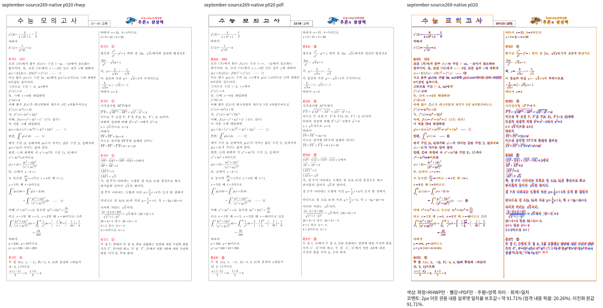

# 논리 괄호의 글줄 분류 보정과 9월 원본 Native 회귀 복구

Issue: #7642

[원인과 소비 경로](task_m100_7642_stage269.md)의 후보
`6c172496124874247fe4ebb3c7b26961a0c0658e`를 Native로 빌드했다.
종료 코드 0, 341.318초, source hash 유지 true이며 실행 파일 SHA-256은
`d90d335fbfddcf3b5849b5e5470c60181eaaf5b6ee2dc72def67ca1e9a24a91e`다.
`1d823bb13667fa7e6637e8480960daae99398577`로 main에 통합했고
소스·글꼴 등 1526개 파일의 해시 불일치 0을 확인했다.

## 같은 원본·독립 Print PDF의 Native 전쪽 확인

| 입력 키 | 전체 쪽수 | 최저 일치율 | 실행 결과 |
|---|---:|---:|---|
| `all-02` | 23 | 91.71442% | complete |
| `all-03` | 23 | 91.73166% | complete |
| `all-12` | 18 | 91.37758% | complete |
| `all-13` | 18 | 91.44094% | complete |

9월 HWP/HWPX 20쪽의 76.59445/76.57746% 회귀가 복구됐다.
표시 트리의 글줄 분류와 후속 문단 전진을 같은 입력으로 대조했다.
math8은 99.59499%를 유지했고 독립 구분자·항 문맥 24/64/32개 자료의 Native도
98.51842/98.48803/99.29034%다. 큰 차이의 원인으로 임시 합집합 높이를
글줄 종류와 동일시하던 가정을 제거했다. 이 숫자를 화면 좌표나 허용치로 쓰지 않는다.

[Standalone overlay](../pr/assets/issue_7642_stage273_font_line/native-september-p020-overlay.png)

## 전범위 검증과 실제 미완료 범위

Source269 전체55 원본·853쪽 Native 큐를 시작했다. 같은 소스·입력/PDF·
바이너리 해시와 전체 쪽수가 확인된 기존 5개 결과만 재사용하고 나머지를 산출한다.
Source261의 미완료 Native 큐는 최신 후보로 대체해 종료했고 완료19개 결과를 보존했다.
Source261 WASM 큐는 HWPX 23쪽의 Chromium launch 실패 후 TSV 누락으로
종료됐다. 성공5개 결과와 실패 로그를 보존하며 이 종료를 PASS로 세지 않는다.

전체 Rust는 같은 후보의 review worktree와 공용 target/pr-review에서 실행 중이다.
첫 두 실행은 sparse worktree의 문서·로고·폰트 입력 부족으로 컴파일 단계에서
종료됐으며 실제 회귀 실패 수로 세지 않는다. 단순 include 매크로의 모든 입력을
사전 대조해 Main의 같은 원본을 참조하도록 보완한 뒤 Stage275로 재실행했다.
원본 데이터를 변경하지 않고 실행 전후 해시를 확인한다. generated 상태는
review worktree에만 준비하며 PR에 stage하지 않는다.

Source269 fresh WASM은 전체 Rust 종료 뒤 동일 공용 target에서 순차 빌드하도록
대기 중이다. 현재 이 소스의 WASM·확대 판독·정식 새 관계 회귀·전체 Rust/lint·
Studio·PR·CI·merge·후속 처리는 아직 미완료다. Native 부분 복구를 최종 승인으로
보고하지 않는다. TSV·로그·중간 JSON·nextrun은 ignored output에만 보존한다.
