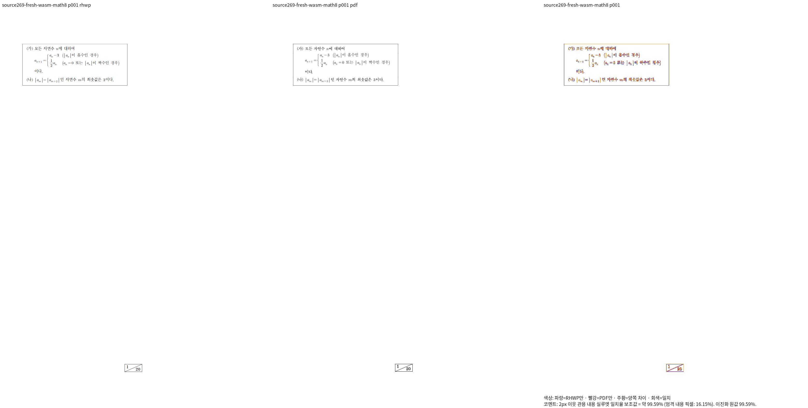

# Stage 282 — 최신 WASM 증적과 전체 회귀 실패의 재판정

Issue: #7642

## 검증 소스와 기준

- Main은 `a255a7e0ce90c110e6fe42acc13274d6239a5cbc`에서 시작했다.
- 고정 검증 소스는 `6c172496124874247fe4ebb3c7b26961a0c0658e`이다. Native 빌드와 fresh WASM 빌드가 소비한 1,526개 소스·글꼴 파일의 해시는 동일하며, Main 구현과도 일치한다.
- `upstream/devel`을 fetch한 결과 기준 SHA는 `552f5228d2dbfd6046c838f14241704f1bcb8a05`로 유지됐다. Main에 포함된 기준이므로 리베이스하지 않았다.
- 모든 컴파일 산출물은 공용 `target/pr-review`를 사용한다. 사용자 지시에 따라 **다음 컴파일부터 `CARGO_BUILD_JOBS=6`**, 테스트 실행은 별도로 `--test-threads 12`를 적용한다. 이미 시작한 WASM 빌드의 jobs3은 중단하지 않고 종료했다.

## fresh WASM 완료 범위

WASM wrapper는 고정 검증 worktree의 저장소 루트에서 실행했으며 exit0이다. 소스 해시 보존과 그 worktree의 `pkg/`·Studio public 패키지 SHA 일치를 확인했다. 검증 package snapshot을 Main의 루트 `pkg/`와 `rhwp-studio/public/`에도 반영하고 두 경로의 JS·WASM SHA 일치를 다시 확인했다. JS binding은 기존 추적 파일과 같아 별도 변경이 발생하지 않았다. 브라우저 동작 확인은 아직 완료하지 않았다.

| 원본·독립 Print 기준 | 전체 쪽수 | Native 최저 | fresh WASM 최저 |
|---|---:|---:|---:|
| `samples/exam_math_8.hwp` / `pdf/issue7642-exam-print/exam-05-exam_math_8-hwp-print-2020.pdf` | 1 | 99.59499% | 99.59499% |
| `pdf/issue7642-small-delimiter-diagnostic/` | 1 | 98.51842% | 98.51842% |
| `pdf/issue7642-term-context-diagnostic/` | 3 | 98.48803% | 98.48803% |
| `pdf/issue7642-term-context-extra-diagnostic/` | 1 | 99.29034% | 99.29034% |

검증 원본 HWP와 독립 한컴 Print PDF는 해당 디렉터리의 기존 커밋 자료를 사용했다. 모든 쪽의 누락·중복과 양쪽 쪽수 일치를 검사했다. `exam_math_8.hwp`의 새 review에서는 이전 수식 뒤 본문 간격의 큰 차이가 해소된 것을 확인했다. 다음 이미지는 같은 소스의 **fresh WASM 재출력**이다.

`exam_math_8.hwp` 입력 SHA-256은 `f29e0d92c45c51306a482c9304e70820a18f55ec8c44b6cdffc26db0e54645ff`,
실제 Print PDF SHA-256은 `a4aab7757207e2cc4838afd739641d5ea1546f3b0a57944a5dbca3e7bf3e2d6f`다.

[독립 overlay](../pr/assets/issue_7642_stage282_fresh_wasm/wasm-math8-p001-overlay.png)

항 문맥 진단의 동치 표기는 `a _n -3`, `a _n - 3`, `a _n {-3}`, `{a _n} -3`이다. 독립 한컴 저장 레코드에서 같은 글자 크기의 예약 폭이 같음을 확인했다. 현재 소스의 관계 검사 후보는 원본 소유·누락·중복, a·아래첨자 n·빼기·3의 순서, 평평한 표기와 묶인 표기의 상대 글리프 원점·기준선·글자 크기 일치를 검사하며 1/1 통과했다. 고정 화면 위치나 px 허용치를 사용하지 않는다. 아직 ignored 진단 후보이며, **정식 `tests/cases/` 추가와 수정 전 FAIL 입증은 미완료**다.

## 전체 Rust 실행과 누락 입력 보완

첫 전체 nextest는 10,260개 실행 중 9,919 통과·341 실패·45 skip, exit100이었다. 그때 sparse review에 부족했던 추적 자료를 Main 원본에 연결해 재검사했다. 테스트 assertion·baseline은 바꾸지 않았다.

| 실행 | 실제 결과 | 판정 |
|---|---|---|
| Stage 275 전체 Rust | 9,919 통과 / 341 실패 / 45 skip | 실패, 완료 선언 불가 |
| Stage 280 실패 341개 재실행 | 284 통과 / 57 실패, exit100 | 소스·원본 해시 보존, 57개 추가 분석 필요 |
| Stage 284 캡슐 audit 단독 재확인 | 1 통과 / 0 실패 | fixture symlink의 파일 종류 차이만 보완 |

캡슐 audit는 `DirEntry::file_type().is_file()`이 fixture symlink를 일반 파일로 세지 않아 실패했다. review worktree의 해당 링크 한 개만 **동일 바이트의 일반 파일**로 복사한 뒤 같은 컴파일된 테스트를 실행해 통과했다. Main 원본과 테스트 코드는 변경하지 않았다. 이 단독 결과를 전체 Rust 통과로 보고하지 않는다. 나머지 56개 실패는 여전히 미해결이다.

## 진행 중과 남은 범위

- 요청 원본 52개와 추가 대조군 3개·전체 853쪽의 같은 소스 Native 전체 비교와 fresh WASM 전체 비교가 진행 중이다. 위 네 항목의 통과를 전체 55개 문서의 통과로 대신하지 않는다.
- 두 전체 queue 뒤에 수식 카탈로그·구조·첨자 등 9종, 183쪽을 각각 Native/fresh WASM으로 재검증하도록 연결했다.
- 기존 카탈로그·구조 대조군의 미달 페이지는 보존한다. 한컴 2024 정상 저장·Print에서도 같은 차이가 관측됐지만 원본의 시각 통과나 출력 예외로 판정하지 않았다.
- Source269의 fmt·세 Clippy 경로·workspace build·base 고정 정책 검사는 jobs6으로 순차 실행한다. 이 사전 검사 뒤 코드·테스트가 변경되면 영향 게이트를 다시 실행해야 한다.
- 전체 실패 보정, 새 이름의 정식 관계 회귀 및 수정 전후 실행, 최종 lint·정책·Studio, PR·code CI·self review/오늘할일 trailing CI·merge·후속 처리는 아직 완료하지 않았다.

## 재현 증거 위치

아래 파일은 ignored `output/pr-review/issue7642/failed-inputs-20261008/stage15-current-validation/`에 보존한다. TSV·로그·JSON·다음 실행 기록은 Git에 포함하지 않는다.

- `stage269-fresh-wasm-build.json`, `stage269-fresh-wasm-package/`
- `stage282-fresh-wasm-review-and-studio-sync.json`
- `stage281-source269-{all-40,delimiter-24,term-64,term-32}-whole-wasm/`의 전체 `silhouette.tsv`와 manifest
- `stage280-failed-tests-retry/{receipt.json,nextest.log}`
- `stage280-terminal-failure-diagnostics.json`
- `stage284-capsule-{regular-file-review-data,audit-retry}.json`
- `stage284-term-source-records.json`, `stage284-term-group-relations-prototype.{rs,json,log}`
- `stage283-source269-nine-families-{native,wasm}.json`
- `stage285-source269-lint-policy/`
