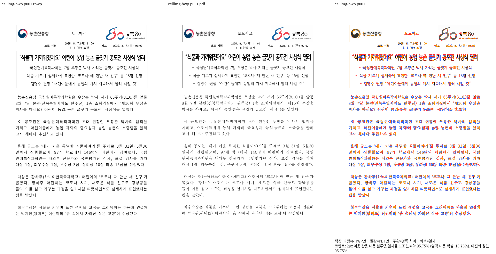
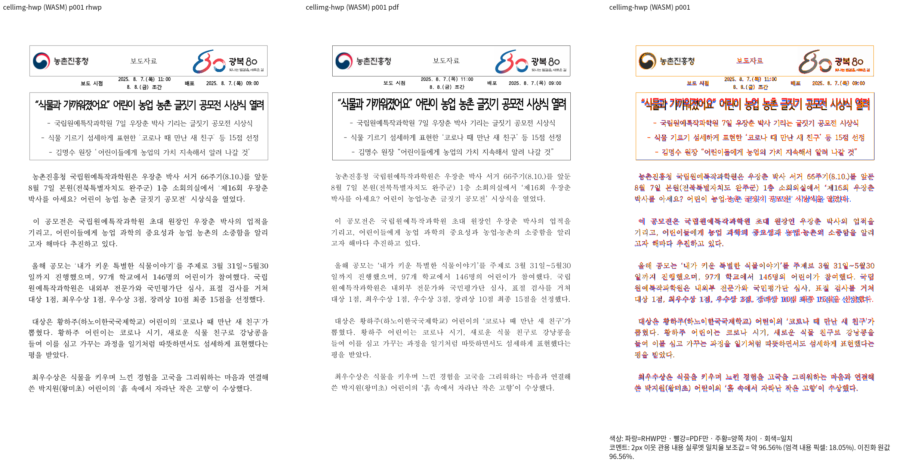

# #7902 1단계 — Visual Sweep 직접 PNG 개선의 로컬 검증

Issue: #7902. 사용자 지시에 따라 **Visual Sweep 개선만 먼저 별도 PR로 제출**한다.
이 단계는 #7902의 문서별 조판 결함을 해결하거나 이슈 종료를 주장하지 않는다.

## 코드와 출력 범위

- 검증 code head: `d56b6c1106bbe0292c1c11e3bfaba2286cdfb43c`.
- base: `b3eaf7b10b15a2d40810d42acdcf4de6c1ba026b`.
- 기본 `--rasterizer png`: Native Skia `export-png --profile print` 및 fresh WASM Print Canvas.
- `--rasterizer svg`: 종전 SVG/Chrome 진단을 유지한다. 서로 다른 backend의 resume를 거부한다.
- Native는 명령별 글꼴 snapshot과 같은 문서의 선택 쪽 render tree를 재사용한다.
  `--json`, `--metadata-only`, 반복 `-p`, `--render-tree-output`, `--font-environment`를 지원한다.
- WASM은 작업자별 Chrome·탭·문서를 재사용한다. 같은 문서의 글꼴 resource와 실제 Canvas
  family 사다리를 공급하고 글꼴·비동기 그림 준비 뒤 다시 그린다. 파일 SVG는 생성하지 않는다.
- Studio·Chrome/Edge/Firefox 확장·공통 WASM 렌더러 소스는 수정하지 않았다.
  CLI/MCP에는 PNG JSON 계약과 도구 자기서술을 추가했다.

## 실제 전쪽 비교

동일 원본·독립 한컴 Print·2022 compat·96dpi·Print profile에서 전쪽 비교했다.
각 경로13쪽, 합계26쪽이다. 원본과 PDF SHA·명령·producer SHA는 아래 원시 기록에 있다.
fresh WASM은 공용 target에서 현재 library source의 release package를 새로 빌드한
`--no-opt` 검증 산출물이다. 후속 CLI/MCP 자기서술 변경은 WASM library에 포함되지 않는다.

| 원본 / Print | 쪽수 | Native 최저 | fresh WASM 최저 | 미달·누락 / 쪽수 불일치 |
| --- | ---: | ---: | ---: | --- |
| `samples/table-vpos-01.hwp` / `pdf/table-vpos-01-hwp-2020.pdf` | 5 | 98.84071% | 98.50488% | 0 / 없음 |
| `samples/issue2004_cell_image_stack.hwp` / `pdf/issue2004_cell_image_stack-hwp-2020.pdf` | 8 | 95.75413% | 96.55826% | 0 / 없음 |

[Native/fresh WASM 전쪽 TSV 원본 4개](https://gist.github.com/jangster77/3c3ebc08de3f4d618045feec75b742f2).
대표1쪽의 compare·standalone overlay·review를 새로 산출했다. 머리말 로고·제목·표 외곽·본문
줄바꿈·문단 간격을 독립 PDF와 대조했다. 누락·큰 위치 이동·겹침은 보이지 않았으며 글꼴 획과
래스터 차이는 남는다. 점수는 전체 렌더링 정확도가 아니라2px 관용 실루엣 보조값이다.

## 성능 비교

같은5쪽 원본·Print·공급 글꼴·고정 Native binary/fresh WASM package로 비교했다.
빌드 시간은 제외했다. 다른 검증도 실행 중이던 환경의 단회 관측이다.

| 경로 | 작업자 | TSV 완료 | 전체 산출물 |
| --- | ---: | ---: | ---: |
| Native SVG/Chrome | 1 | 40.27초 | 208.27MiB |
| Native 직접 PNG | 1 | 13.81초 | 1.84MiB |
| Native 직접 PNG | 4 | 11.62초 | 1.84MiB |
| fresh WASM SVG/Chrome | 4 | 64.42초 | 470.00MiB |
| fresh WASM 직접 PNG | 4 | 36.48초 | 17.59MiB |

Native4는71.1%, WASM4는43.4% 단축됐다. 직접 PNG의 파일 SVG는0개다. Native PNG1/4의
PNG·TSV 바이트는 같으며 SVG/PNG의 paint 결과까지 동일하다고 주장하지 않는다.
WASM 용량에는 private 공급 글꼴 사본이 포함된다. 글꼴 파일은 Git·공개 증적에 포함하지 않는다.

## 검사와 보완

- Python Visual Sweep 검사135개 통과. 신규 직접 PNG 계약 검사13개 포함.
- 기존 PNG 기본 screen/placeholder 호환성 검사2개 통과.
- CLI JSON 검사31개 통과. 첫 실행은 MCP 목록의 PNG 누락으로1개 실패했고, 도구 배선
  보완 후 동일 검사31개가 통과했다. 테스트를 완화하지 않았다.
- fmt, Native Skia Clippy, 기본 Clippy, WASM Clippy, workspace build,
  workspace all-targets Clippy 및 manifest base 비교 모두 통과했다. Cargo는 jobs8·공용
  `/home/tsjang/rhwp/target/pr-review`를 순차로 재사용했다.
- 수정 문서의 내부 링크 검사 통과. 기존 base의 삭제된 시험지 검사 링크는 삭제 이력을 명시한
  역사 기록으로 교정했으며 시험지 파일·회귀를 복원하지 않았다.
- 완료된 페이지의 Native/fresh WASM 실루엣이 각각98% 이상이면 독립 PDF 좌표의 ±2px 회귀를
  허용한다. 그 쪽은 이후에도 양쪽98% 이상을 유지하고100%로 개선은 허용한다. 세부 계약은
  [페이지별 좌표 회귀 지침](../manual/pr_review/visual_fixture_evidence.md#완료-페이지의-98-이상-실루엣과-px-좌표-회귀)을 따른다.

## 원시 기록과 후속

ignored `output/pr-review/visual-sweep-direct-png-20261014/`:

- `final-head-verification-result.json`: code SHA·입력/PDF SHA·명령·전쪽 수·최저값.
- `final-review/{native,wasm}/`: 해당 code head의 대표 PNG·manifest·직접 raster.
- `final-benchmark-result.json`: 전후 명령·시간·용량·고정 producer SHA.
- `final-required-lint-result.json`, `python-tests-final-135.log`,
  `png-compat-focused.log`, `cli-json-focused-fixed.log`: 실행 결과.

원격 PR #7903을 생성했고 정확한 head의 CI를 검증 중이다. 사용자 선택 옵션 2에 따라
CI 성공 확인 후 merge하고, 개별 PR review·오늘할일은 새 문서 전용 PR로 반영한다.
#7902의 화학제품 쪽번호,
행 나눔 HWPX 및 giant overfill 보정과 전체19문서 재검증은 다음 단계다.

### PR #7903 CI 분류 검사 보완

제출 head `35f7ad287162ac27b80f6c8844f6f75037bfcf29`의
[Lint 작업](https://github.com/edwardkim/rhwp/actions/runs/38542913652/job/115782479679)은
Rust fmt 뒤 `Validate CI impact classifier`에서 실패했다. 로컬 Rust lint 묶음은 통과했으나
이 별도 Node/Python 묶음은 PR 전 검증에서 빠졌다.

원인은 PNG 호출을 `NativePngExporter::new/system_defaults`와 `render_page`로 옮긴 뒤
기존 직접 `render_page_png_native` 정규식이 CLI raster 소비자를 찾지 못한 것이다.
실제 CI 분류의 Native Skia 필요 판정은 유지한다. 탐지 검사를 새 snapshot replay까지
포함하도록 보완하고 생성만 하는 코드·다른 exporter의 호출을 구분하는 검사를 추가했다.
CI의 해당 단계8개 명령을 같은 순서로 로컬 실행해 Node 219개·Python 38개 검사 모두
통과했다. 결과는
`output/pr-review/visual-sweep-direct-png-20261014/ci-impact-bundle-result.json`에 기록했다.
이번 보완은 호출 탐지 검사와 작업 기록만 변경한다. Rust source·실제 CI 분류·렌더 결과가
같으므로 기존 Rust lint와 Native/fresh WASM 증거를 재사용하며 전체 Rust 회귀는 재수행하지 않았다.
사용자 지시에 따라 보완 결과를 같은 PR의 추가 commit으로 반영한다. 원격 CI 성공·merge는
최신 head에서 따로 확인한다.

### CodeQL #277 — HTTP 오류 응답의 내부 정보 노출 보완

`822ed2bf7`의 [CodeQL 지적](https://github.com/edwardkim/rhwp/security/code-scanning/277)은
글꼴 읽기 실패의 `String(error)`를 HTTP 응답으로 보내는 경로다. 127.0.0.1 검증 서버여도
파일 경로·예외 상세를 응답으로 공개할 필요가 없다. HTTP 500은 고정 문구로 응답하고
상세 오류는 로컬 stderr에만 남긴다. 경로 allowlist와 글꼴 SHA 검사는 유지한다.

실제 서버에 요청하는 검사에서 수정 전 누락 파일·SHA 불일치의 정보 비공개 계약 2개가
실패했다. 수정 후 오류 응답 2개와 정상 바이트·경로 순회 차단 대조군 2개가 모두 통과했다.
이 검사는 CI Lint의 별도 `Validate Visual Sweep PNG server` 단계에 연결했다.
서버 검사 4개·Node CI 정책 검사 177개·Python workflow 검사 66개·Visual Sweep 검사 135개,
수정한 CI YAML의 actionlint가 모두 통과했다. Rust source는 바꾸지 않았다.
원시 기록: `security-server-before.log`, `security-server-after.log` 및
`security-png-protocol.log` (위 ignored 결과 디렉터리).

### 전체 회귀에서 확인한 PNG 자기서술 계약 보완

사용자 지시에 따라 수정 전 head `b5040558942a4ed4e22deb2c643a6df87d71e5f7`에서
공용 `target/pr-review`, Cargo jobs8, release-test, test-threads12, no-fail-fast로
전체 회귀를 수행했다. 컴파일23분37초·검사1640.684초:
**10,285개 실행 / 10,280 통과 / 5 실패 / 45 제외**.

| 실패 검사 | 보완 |
| --- | --- |
| `mcp_schema_matches_live_manifest_output` | 선택적인 MCP `available`·`requiresFeature` 타입 선언 |
| `every_stateless_tool_belongs_to_some_specific_profile` | PNG를 콘텐츠제작·품질검증 업무에 연결 |
| `every_declared_record_field_is_in_the_dictionary` | 출력 프로필·조판 세대 등재, 실제333개 선언/341개 사전으로 개수 정합 |
| `provenance_map_covers_every_json_command` | PNG 매니페스트의 문서 값 없음 근거를 공통 출처 지도에 등록 |
| `every_text_bearing_command_declares_untrusted_fields` | Native PNG 실제 호출 레시피 추가, 실행 불가능한 빌드는 명시적 feature 근거로 호출만 제외 |

출처 지도 선언 검사는 비가용 명령까지 유지한다. 문서 입력 명령을 면제 목록에 넣지 않았고,
Native Skia에서는 PNG 레시피를 실제로 실행한다. PNG metadata-only와 렌더 JSON 모두
공통 출처 표지와 표준 `schemaVersion: "1.0"`을 출력하도록 보완했다. PNG 자체의 paint와
레이아웃은 변경하지 않는다.

CI에 이미 연결된 `cli_exit_codes_native`에 실제 PNG 계약 검사를 보완했다.
수정 전과 실행 Rust 코드가 같은 고정 CLI에서 새 검사는 표지 누락으로 FAIL했고,
보완 CLI의 metadata-only/실제 PNG·feature/MCP 계약2개와 Native 출처 검사10개가 PASS했다.
수정 후 첫 전체 실행은 컴파일16분48초·검사1084.262초로
**10,285개 실행 / 10,283 통과 / 2 실패 / 45 제외**였다. 위5개는 모두 통과했고,
공통 출처 지도에 PNG를 추가하면서 스킬 카탈로그·fixture의 명령 정합성 검사2개가
누락을 검출했다. `.claude/skills/rhwp-provenance`의 두 자료에 같은 PNG 봉투 계약과
산출 PNG·render tree를 재소비할 때의 미신뢰 데이터 경계를 추가했다. 검사 자체는 유지한다.
Rust 소스는 첫 수정 후 실행과 동일하게 고정하고, 최종 전체 회귀와 필수 Rust lint/정책을
공용 캐시에서 순차 실행했다. **최종 전체10,285개 통과 / 실패0 / 제외45**, exit0이다.
최종 컴파일5분13초·검사1129.782초였다. 스킬 계약12개도 별도로 통과했다.
fmt·Native Skia Clippy·기본 Clippy·WASM Clippy·workspace build·workspace all-targets
Clippy·고정 base manifest 비교가 모두 통과했고 검증 중 추적 변경 파일의 내용은 고정했다.
문서 링크 검사에서 기존 카탈로그의 `failed`가 링크로 해석되는 오류1건을 발견해
필드명을 코드 표기로 교정했다. 이후 변경 문서의 링크와 공백을 다시 검사한다.
파생 suite 준비가 같은 내용도 다시 쓰는 동작을 확인했다. 이미 현재 소스의 suite를
준비한 검증에서는 그 준비를 불필요하게 반복하지 않아 재컴파일을 피한다.
원시 로그: `full-regression-before-fix.log`, `full-regression-before-fix-result.json`,
`png-provenance-before-native.log`, `post-fix-native-png-contract.log`, `post-fix-native-provenance.log`.
최종 기록: `final-full-regression.log`, `final-complete-validation-result.json`,
`final-{native,default,wasm,workspace}-clippy.log`, `png-skill-contract-after-fix.log`.
