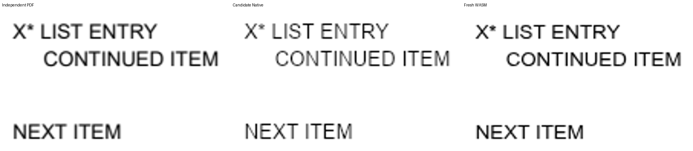
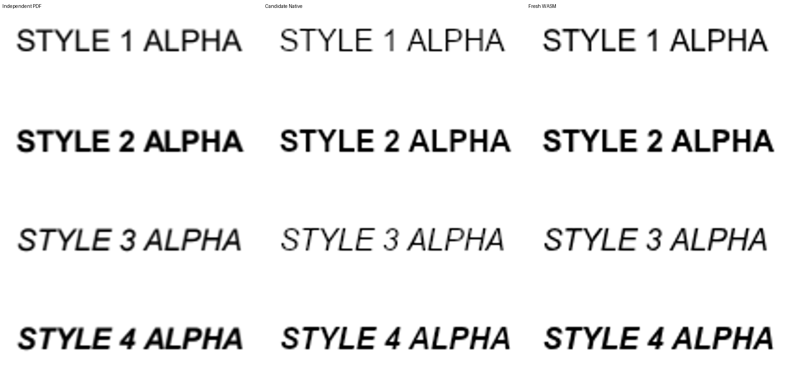
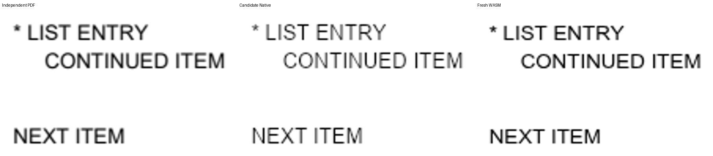

# #8109 2단계 — 명시적 대체의 생산과 저장·재열기 소비

- 날짜: 2026-10-21. 작업지시자의 2단계 진행 승인을 받아 구현·집중 검증을 완료했다.
- 기준 code: `80968497c2c178eeecb3b2e1d04d086ad27a0dc7`; 시작 문서 head: `74a2719cc`.
- [수행계획](../plans/task_m100_8109.md), [구현계획](../plans/task_m100_8109_impl.md),
  [독립 근거·원 해결 PR 추적과 최소 계약](task_m100_8109_stage1.md)을 이어서 적용했다.
- 결과: 프로그램이 없는 표준 Type1 Helvetica의 원래 이름·AFM 측정을 보존하면서 Arial 대체를
  문서에 명시한다. HWP의 대체 이름과 독립 type byte도 공통 모델로 읽어 양 저장·재열기가 소비한다.
  3단계의 전체 lint·회귀 및 최종 커밋 기준 검증은 다음 단계이며 PR 제출 완료 판정은 아니다.

## 적용 규칙과 실제 소비

| 생산/소비 | 구현 위치와 계약 |
| --- | --- |
| 프로그램 선언 | vendor `fonts/font_dict.rs:1508,2005`: Type1 descriptor 없음/정상 dictionary의 program key 없음만 `Some(false)`. 선언된 FontFile/2/3의 디코딩 실패는 존재 상태이며 잘못된 descriptor는 unknown이다. 기존 bounded recovery 거절도 유지한다. |
| 실제 resource 소속 | vendor `extractors/text.rs:3737,3776,4709`: text-show를 해석한 FontInfo Arc를 paint order에 함께 보존한다. Form의 같은 `/F1`·BaseFont 이름으로 다른 resource를 합치지 않는다. |
| 추출 → IR | vendor `document.rs:12900` → `parser/pdf/extract.rs:55` → `lowering.rs:366`: 실제 scoped font가 Type1·program absent·표준 Helvetica 네 스타일일 때만 `SubstFont { face: Arial, font_type: 1 }`을 생산한다. 같은 이름의 대체 유무가 다른 font entry도 구별한다. |
| 측정 → 실제 paint | 원래 `Font.name`·CharShape·Adobe Core14 AFM 경로를 보존한다. 스타일 resolver가 `Helvetica,Arial`을 생산하고 Native Skia는 공급된 Arial을 실제 선택했다. Studio의 실제 `fillText` font 문자열에도 두 family가 전달됐다. |
| HWP → 공통 모델 → HWPX | `parser/doc_info.rs:297`에서 HWP table19의 alternate face와 그 type byte를 `subst_font`로 정규화하며 기존 `alt_name`도 보존한다. `serializer/doc_info.rs:489`는 일치하는 대체의 독립 type을 기록한다. HWP3의 원본 이름용 alt_name을 전역 대체로 해석하지 않는다. |

이 경로에는 새 원점/높이·줄 나눔의 재계산, paint clamp, font size·장평·자간·alpha 보정이 없다.
원본 목록의 변경 전후 CharShape 배열도 완전히 동일했다. Type1이 아닌 Helvetica, ArialMT,
embedded/unreadable program, unknown descriptor는 새 정책의 대상이 아니다.

## 빌드와 실행 신원

공용 `target/pr-review`를 순차 재사용했다. Native 빌드 뒤에 Docker WASM을 실행했고, 그동안의
작은 검사들은 완성된 Native 라이브러리를 읽는 standalone rustc test 경로로 실행했다.

```bash
CARGO_BUILD_JOBS=14 cargo build --locked --profile release-test --features native-skia \
  --lib --bin rhwp --target-dir /home/edward/mygithub/rhwp/target/pr-review

docker compose --env-file .env.docker run --rm --no-deps \
  --user "$(id -u):$(id -g)" --env HOST_UID="$(id -u)" --env HOST_GID="$(id -g)" \
  --env CARGO_TARGET_DIR=/review-target --env CARGO_BUILD_JOBS=14 \
  --env CARGO_PROFILE_RELEASE_CODEGEN_UNITS=16 \
  --volume /home/edward/mygithub/rhwp/target/pr-review:/review-target wasm \
  sh -ec 'rm -f pkg/*-opt.wasm; scripts/wasm-pack-locked.sh --target web --out-dir pkg'
```

- Native: 성공, 3분47초. WASM: wasm-opt 포함 성공, 9분42초.
- Native SHA-256: `8c4b7b6334758da36b78568d0fcde72691130a6d1befaa99644ad6db188fe78e`.
- WASM SHA-256: `b8c20fcfe5952ed2a1d3f4188842438275f4a964bceaa55f1f170fc6d640ffe1`.
- JS SHA-256: `1c40e6aa15e5b87643148b717fba0683ae622910e96e369659465d2c0abfab9a`.
- `pkg/`·Studio public WASM·Chrome가 실제 받은 response body의 해시가 일치한다.
- 검증 당시 modified Rust 파일별 해시와 base는 ignored
  `output/pr-review/issue8109/stage2/producer-identity.json`에 고정했다. 해당 코드와 이 보고서를
  함께 로컬 커밋하며, 3단계는 그 커밋 SHA에서 정식 전체 검증을 시작한다.
- Arial regular/bold/italic/bolditalic 및 기존 Batang 두 프로그램의 총48,168,100바이트를
  동일하게 양쪽 비교에 공급했다. 공급 파일 신원은 `stage2/font-programs.json`에 보존했고
  상용 font 파일은 커밋하지 않았다.

## 독립 Print와 전쪽 시각 검증

변경한 실제 Native 저장본과 Studio 편집·undo/redo 뒤 저장본을 각각 Hancom2020 Print했다.
바이트가 같은 입력만 SHA-256으로 alias 처리했다. source/Print SHA와 모든 후보 TSV는
[입력 신원 표](../pr/assets/issue_8109/stage2/inputs.tsv)에 연결했다.
서버 job status/download 원문은 `stage2/print-jobs/`, 바이트 alias는 `print-manifest.json`에 있다.
대기열 8개 한도에 의해 명시적으로 거절된 요청 하나는 실패 기록을 보존하고 순차 처리로 전환했다.
접수된 job을 중복 제출하지 않았다.

- actual engine2020, Hancom `11.0.0.9136`, `pdf_print_method=0`,
  `hancom2020_pdf_driver_one_up`을 확인했다.
- 목록의 새 무편집/X 삽입/직접 삭제 저장본은 ArialMT로 출력됐다. 네 스타일 대조군은
  ArialMT·Arial-BoldMT·Arial-ItalicMT·Arial-BoldItalicMT였다.
- 기존의 명시적 대체 HWPX를 HWP로 저장·재열기·HWPX 재저장한 Print도 ArialMT였다.
- 과거 대체 필드 없이 저장된 파일은 origin PDF의 program 부재를 복구할 근거가 없다.
  모든 Helvetica HWP에 전역 alias를 추가하지 않았으며, 과거 Native89%대 파일이 이 수정으로
  자동 복구됐다고 보고하지 않는다. 이번 해결은 새 import의 명시적 선언과 표준 대체 필드 보존이다.

| 비교 범위(각 backend의 논리 입력 수) | Native 최저 raw% | fresh WASM 최저 raw% | 쪽수 |
| --- | ---: | ---: | --- |
| 원본 목록 + 성공하는 resource 대조군 10개 (11) | 100.00000 | 98.35575 | 전부1=1 |
| Native의 새 저장·교차 저장/Print (18) | 99.63470 | 99.63691 | 전부1=1 |
| 독립 명시적 대체 HWPX/기존 동일 입력 Print (1) | 100.00000 | 100.00000 | 1=1 |
| Studio PDF/HWP/HWPX 재편집·undo/redo 후 양 저장/Print (6) | 100.00000 | 100.00000 | 전부1=1 |

각 backend36개, 합계72개 후보 쪽의 원문 TSV를 보존했다. source/control의 변경 전22개 TSV도
같은 asset의 `before/`에 있다. 동일 font 공급의 base 대비 하락은 없었다. Native source는
+0.06575%p, 네 스타일은 +0.16015%p; WASM 스타일은 +0.03072%p이며 나머지는 같았다.
잘못된 indirect descriptor 사례는 수정 전후 동일한 `PDF_RESOURCE_LIMIT` 거절을 검사한다.
정상 출력이 없는 오류 입력을 시각 완료 문서에 포함하지 않는다.

TSV와 대표 PNG는 `scripts/visual_sweep.py`를 Native/fresh WASM에서 각각 실행했다.
원본 대조군은 같은 PDF, 새 저장본은 그 바이트의 독립 Print를 기준으로 했다. 대표 명령은 다음과 같다.

```bash
VISUAL_SWEEP_CHROME=<installed-chrome> venv/bin/python scripts/visual_sweep.py \
  --silhouette-only --rasterizer png --hwp <input> --pdf <independent-reference> \
  --key <key> --rhwp-bin target/pr-review/release-test/rhwp --compat 2022 \
  --dpi 96 --font-path output/pr-review/issue8109/stage2/fonts --embed-fonts full \
  --out output/pr-review/issue8109/stage2/visual/<group>/<backend>
# fresh WASM에는 --wasm-pkg pkg 추가. 대표 review/overlay는 --silhouette-only 없이 재실행.
```

실행별 전체 명령·입력/Print 해시는 ignored `stage2/visual/*/*/results.json` 및 로그에 있다.
72개 TSV 외에도 목록·스타일·HWP→HWPX 경계의 compare/overlay/review를 양 backend에서 생성했다.
같은 영역 4배 확대의 독립 PDF/Native/WASM을 직접 판독했다. 목록 두 줄·후속 문단의 순서와
들여쓰기, X의 삽입/삭제, 네 스타일의 기울기·굵기·기준선과 공백, 교차 저장의 글자 모양을 확인했다.
수식은 이 입력들에 없다. 글자의 농도는 rasterizer별 차이가 남지만 줄 구성·glyph 모양·간격의
새 결함은 확인되지 않았다. embedded negative control은 기존 font 출력 한계를 유지한
비적용 대조군이며 그 program의 새 렌더링 지원을 주장하지 않는다.





## 실제 Studio와 회귀

Chrome CDP의 별도 탭에서 fresh WASM PDF import → Studio load, HWP/HWPX 재열기 각각을 실행했다.
각 경로에서 noop → X 삽입 → 직접 삭제 → Snapshot 삽입 → undo → redo → undo → 양 저장을
실행해 원문과 한 쪽을 확인했다. `stage2/studio-results.json`, `studio-wasm-identity.json`,
`studio.png`에 관측을 보존했다. 실제 Canvas2D fillText의 font descriptor에 `Helvetica, Arial`이
전달됐다. CSS는 실제 사용한 개별 glyph face를 공개하지 않으므로 trace의 `notObserved`를
Native의 관측값처럼 승격하지 않았다. 별도 탭은 검증 후 닫았다.

시각 선행 조건과 직접 판독을 마친 뒤
[정식 회귀](../../tests/cases/issue_8109_pdf_font_substitution.rs) 6개와
[입력·생성/라이선스 설명](../../pdf/issue8109/README.md)을 추가했다.

| 검사 | 수정 전 | 수정 후 |
| --- | --- | --- |
| 원 선언·명시적 대체·양 저장/교차 저장 | 대체 없음 FAIL | PASS |
| 독립 HWPX의 HWP alternative/type 소비·재저장 | 대체 유실 FAIL | PASS |
| 프로그램 존재/unknown/타 subtype·Arial 경계와 Form resource 분리 | absent의 대체 없음 FAIL | PASS |
| 같은 이름의 Form별 실제 paint chain·내용 순서/중복 없음 | chain 미분리 FAIL | PASS |
| 네 스타일의 최종 paint chain·굵게/기울임·내용 보존 | 명시적 chain 없음 FAIL | PASS |
| unresolvable font의 기존 bounded rejection | PASS | PASS |

최종 **같은 정식 테스트 소스**를 frozen pre-fix rlib와 candidate rlib에 각각 연결해 실행했다.
before1 PASS/5 FAIL, candidate6 PASS/0 FAIL이다. 빌드 실패를 원인 FAIL로 세지 않았다.
로그는 `stage2/before/final-contracts.log`, `stage2/final-contracts.log`다.
기존 #7998 목록/본문 indentation의 source·재열기 뒤 직접 편집/역삭제·양 저장 관계 검사도 PASS,
기존 #7810 HWP3/한컴 변환본 8쌍의 font name 검사도 PASS다.

집중 검사는 `rustc --test --edition=2021 --cfg 'feature="pdf-import"'`에
`-L dependency=target/pr-review/release-test/deps --extern rhwp=.../librhwp.rlib`와
기존 Native Skia link directory를 전달했다. before는 frozen deps/rlib를 우선했다.
새 소스는 기존 `tests/cases/` 자동 수집 대상이다. CI 개별 호출은 추가하지 않았다.
현재 checkout의 오래된 generated suite 참조 때문에 `cargo fmt --all`은 removed case 경로에서
실패했다. 변경 Rust 파일 각각의 `rustfmt --check`와 `git diff --check`는 통과했다.
3단계는 canonical review worktree의 prepare로 정식 전체 suite를 수집해 실행한다.

## 단계 판정

2단계의 생산/소비 보정·적용/비적용 경계·수정 전후 실제 검사·전쪽90%·쪽수·확대 판독·정식 회귀
등록은 충족했다. 기준값 완화와 기존 회귀 삭제는 없다. 사용자 WIP 문서 해시도 유지했다.
다음은 계획된 3단계의 최종 lint·전체 회귀·Native/fresh WASM·Studio/시각 검증과 결과보고다.
remote push·PR 생성·GitHub 게시·merge는 수행하지 않았다.
