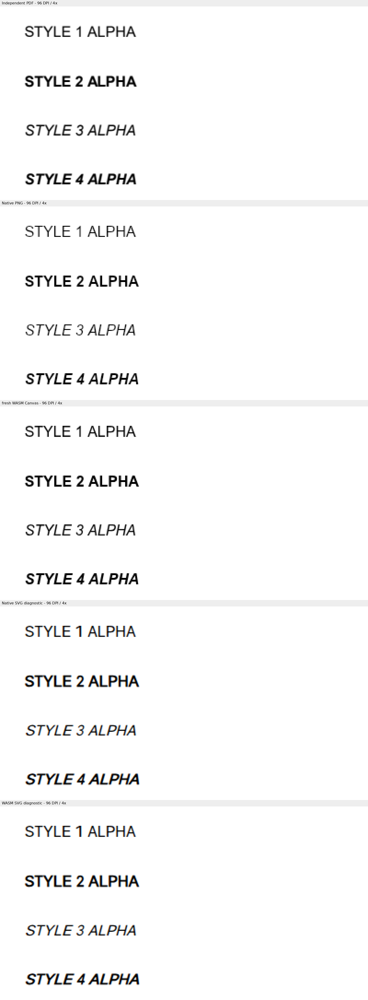

# #8109 3단계 — 최종 검증과 실제 Studio 소비 보정

- 날짜: 2026-10-21. 작업지시자의 “다음 절편 진행을 승인합니다”를 받아 완료했다.
- 기준 `upstream/devel`: `80968497c2c178eeecb3b2e1d04d086ad27a0dc7`.
  2단계 구현 커밋: `5699a377885e3068947400e69a2336af5759112c`.
- [수행계획](../plans/task_m100_8109.md), [2단계 보고](task_m100_8109_stage2.md)를 잇는다.
- 상태: 승인 범위의 구현·필수 로컬 검증·증적 보존 완료.
  [결과보고](../report/task_m100_8109_report.md)의 승인과 원격 게시·push·PR 생성·merge는 별도 게이트다.

## 실제 글꼴 소비에서 추가로 확인한 결함

2단계의 공통 IR은 원본 Helvetica와 명시적 Arial 대체를 보존했다. 최종 검증에서는 실제
CanvasKit 준비·paint가 CSS 후보의 첫 이름만 소비하는 경계를 확인했다. Arial 네 프로그램을
host provider로 공급해도 source/HWP/HWPX의 실제 CanvasKit은 Arial을 사용하지 않았다.
관측 trace의 resolved family가 빈 문자열이었으며 화면에는 검고 좁은 글자가 표시됐다.

선행 구현은 PR #4857의 source catalog(`d5c59b01e13b`, merge `9a40da8818c4`)에서
`f0057d4194d4`와 v2 권위 이관 `2ae4dd4bdeea`까지 추적했다. 기존 Helvetica 공급 URL은
`helvetica-original@1.0.0/Black/Helvetica-Black.ttf`였다. 해당 실제 파일 96,432바이트의
SHA-256은 `b89fbfc64a0600798c93e303fc4b40611f570233ad9008a633e2dcfe7a79564f`다.
fontTools로 직접 읽은 full name은 `Helvetica Neue W02 97 Black Cn`, PostScript name은
`HelveticaNeueW02-97BlackCn`이며 family name은 비어 있었다. family/weight 이름만으로
실제 regular outline을 입증할 수 없다. 이 자료는 ignored `stage3/Helvetica-Black-metadata.json`과
package file 목록에 보존했다. 전역 alias/catalog를 바꾸는 대신 문서가 이미 선언한 후보가
실제 공급·paint까지 이어지도록 보정했다.

| 소비 경로 | 보정과 보호할 경계 |
| --- | --- |
| `host-font-requests.ts` | textRun·charOverlap·footnoteMarker의 전체 후보 순서와 weight/slant로 공급 가능한 local/host face를 선택한다. preflight 요구 목록은 실제 PageLayerTree의 후보와 연결하며 같은 원래 이름의 대체 없는 사용도 보존한다. |
| `main.ts` | 문서에 대체 선언이 있을 때만 실제 각 쪽의 후보를 preflight와 local font 준비에 전달한다. iterator로 한 쪽씩 읽으며 전체 쪽 tree를 배열로 보관하지 않는다. |
| `host-canvas-fonts.ts` | Canvas2D descriptor의 첫 family만 보던 준비 경계를 전체 문서 후보로 연결한다. 원래 후보 문자열도 유지한다. |
| `canvaskit-renderer.ts` | 실제 textRun/charOverlap replay가 전체 후보에서 준비된 local/host Typeface를 소비한다. 없을 때 기존 bundled 경로를 사용한다. 캐시 키에 전체 후보·스타일·host generation을 포함해 같은 primary의 서로 다른 선언을 합치지 않는다. |

측정은 2단계와 같은 원본 Core14 AFM이며 이 보정은 paint resource의 소비를 바꾼다.
글꼴 크기·장평·자간·alpha·원점·줄 높이를 조정하지 않았다. 원래 글꼴을 공급할 수 있는
경우에는 앞 후보를 유지한다. host가 없는 기존 단일-family 경로도 유지한다.

기존 정식 `canvaskit-font-preparation-issue7688` E2E에 실제 공급된 Noto Serif KR 프로그램을
사용한 검사를 연결했다. missing primary + 문서 대체의 실제 renderPage 이미지가 같은 face의
직접 선택 이미지와 같고, 유효한 첫 후보를 보존하며, 대체 없는 같은 primary에 캐시가 새지
않는지 검사한다. 같은 최종 검사 소스를 보정 전 서버에 실행하면 준비 단계에서 의도한 원인으로
실패하고 보정 후에는 통과했다. 기존 actual Regular/Bold 공급 순서와 synthetic italic,
자원 실패 시 Canvas2D fallback 검사도 함께 실행했다. CI 개별 호출은 추가하지 않았다.

늦은 local-font 권한 갱신도 실제 `open-document-bytes → initializeDocument → local-fonts-changed`
경로로 실행했다. helper가 원래 이름만 받는다는 코드 검토상 우려는 전체 호출에서
`prepareCanvasKitDocument`가 공통 후보를 다시 준비해 해소됨을 확인했다. 불필요한 추가
helper 보정은 남기지 않았다. 원래 이름 하나와 명시적 대체만 가진 `only-source-font.hwp`는
정식 serializer로 생성하고 별도 독립 한컴 Print·Native/WASM 전쪽100%·직접 판독 후 보존했다.
이 검사는 정상 유지 대조군이며 수정 전 FAIL 검출 증거로 세지 않는다.

정식 E2E는 이 입력에서 공개 Noto Serif SFNT에 제어된 Arial 별칭을 주고 권한 갱신을 모사한다.
선택된 실제 family는 파일명으로 추정하지 않고 공급 프로그램의 FontMgr에서 독립적으로 읽는다
(`Noto Serif KR ExtraLight`). 실제 Typeface 준비·화면 변화·원본 HWP 바이트/쪽수 보존을
확인했다. 이 합성 자원 선택 계약을 Arial glyph의 시각 일치로 바꾸어 보고하지 않는다.

처음 화면 캡처에 fractional paper 밖 UI gutter가 포함돼 잘못 낮은 점수가 나온 경우는
캡처 경계 오류로 기록했다. zoom 1·DPR 1에서 보이는 paper 사각형 안의 정수 픽셀만
캡처하며 clip 좌표를 JSON에 보존했다. 원문 영역을 가리거나 이미지를 변형하지 않는다.
동일 경계의 보정 전 점수는 99.53639%로 높았지만 확대 판독에서는 잘못된 Black outline이
보였다. 따라서 점수만으로 실제 face 일치를 판정하지 않는다.

## 전체 회귀에서 발견한 기존 메타데이터 가정

첫 release-test 전체는 11,215개 실행, 11,214 PASS·1 FAIL·45 skip이었다. 실패는
`issue_4961_font_decision_trace::font_trace_profiles_follow_source_ownership_and_preserve_font_decisions`의
“HWP counterpart에는 substFont가 없다”는 가정이다. 원 해결 PR #5122와 merge
`0bc05ef81107`, 메인터너 보정 `4c135b707183`, source ownership 보정 `9e0caf780507`,
English slot 보정 `db52d9bc2980`를 현재 코드·manifest와 대조했다.

rhwp parser와 독립적으로 OLE DocInfo를 zlib 해제하고 FACE_NAME(tag 19)의 원시 필드를 읽었다.
`samples/[2027] 온새미로 1 본교재.hwp`(SHA-256
`e8592e74c9a8425c4ee2c5824d012ebe45e9f6dd36880b784ba594b4fd0a31ce`)는
254개 face 중 217개에 alternative 필드가 있으며 `한컴바탕` 등 유효한 선언을 포함한다.
기존 `exact-face` 입력 `samples/143E433F503322BD33.hwp`는 42개 face 모두 그 필드가 없다.
원시 관측은 ignored `stage3/independent-hwp-face-records.json`에 보존했다.

따라서 manifest의 부재 대조군을 기존 exact-face로 지정하고 HWP counterpart를
`한컴바탕` 대체가 보존되는 양성 대조군으로 추가했다. 기존 HWP/HWPX layoutHash의 차이 검사,
source ownership, 각 profile의 기대값 및 #7445로 유보된 render pins는 유지한다.
이 메타데이터 보정에서 렌더링의 좌표·쪽수·golden·허용치를 바꾸지 않았다.
관련 Native 집중 검사 7개가 통과했다.

기존 Node WASM 검사도 이전의 `recordId`와 counts 전체 동등성에 의존하고 있어, 위
`9e0caf780507`에서 이미 Rust 검사에 적용한 sourceAddress와 공개 getPageTextLayout의
실제 소유 관계로 맞췄다. 문자·런·charShape·offset·쪽/문단 소속과 중복 없는 기록을 확인하며
manifest에 선언한 counts 필드는 그대로 검사한다. 보정 후 WASM 검사 2개가 통과했다.

기존 `host-font-provider-issue7403`도 양 backend에서 실행했다. CanvasKit 검사는 마지막
공급자 해제 후 현재 renderer의 face count가 0이기를 기다리다 실패했다. 원 PR #7405
(`aeb9f489e1d5`)의 해제·문서 보존 계약과 이후 #7697(`21ed64071f81`)의 실제 face 준비 실패 시
Canvas2D fallback 계약을 대조했다. 이번 Studio 보정 전 네 파일을 정확한 `5699a3778`
내용으로 공급한 별도 Vite에서도 같은 마지막 대기가 실패했다. 실제 관측은 공급자 해제 뒤
`Next Host`가 없어 Canvas2D로 전환되고 현재 CanvasKit 진단은 null인 정상 fallback이었다.

이 검사의 마지막 경계는 이전 renderer의 실제 face가 0개로 해제됐는지, 공급자 상태가
inactive/count=0인지, 기존 Canvas2D fallback 사유와 누락 family가 기록됐는지, HWP 바이트와
한 쪽이 보존됐는지 확인하도록 맞췄다. Canvas2D의 등록 face=0 검사와 앞의 TTC/slant·측정·
교체·늦은 read 폐기·undo/redo·저장 검사는 유지했다. 잘못된 face를 계속 그리도록 제품을
되돌리지 않으며 렌더링 위치나 golden을 변경하지 않는다.

Studio 전체의 첫 실행은 2,349 PASS·1 FAIL·2 skip이었다. 실패는 초기화 순서 검사가
이전의 `prepareLocalFonts(fontRequirements.requiredFontFamilies)` 문자열을 찾는 데 있었다.
원 local-face 준비 계약 PR #4800(`72952055b3c7`), 이후 #7697의 인자 교정과 실제
snapshot 로드 코드를 읽었다. 현재 문서 후보 변수로 검사를 맞추고, 실제 후보 해소도
snapshot 로드 뒤에 확정하도록 순서를 명시했다. 기존 local 실패 격리와 bundled 준비 순서
검사는 유지하고, 선택 순서 검사도 추가했다. 보정 후 TypeScript와 전체 Studio는
2,350 PASS·0 FAIL·2 skip이다. 실제 browser의 preparation/style·host provider·편집 상태별
실제 Arial 선택도 보정한 코드로 다시 확인했다. Rust 생산 코드는 바뀌지 않았다.

## 실행 환경과 최종 검증 기록

검증 전용 worktree `/home/edward/mygithub/rhwp-review-8109`에서 suite prepare를 실행하고
공용 `/home/edward/mygithub/rhwp/target/pr-review`만 순차 재사용했다. Cargo jobs=6,
nextest threads=8로 메모리와 동시 작업을 고려했다. Docker 최적화 WASM은 scoped jobs=14,
release codegen-units=16을 사용한다. 생성 suite와 manifest는 제출 파일이 아니다.

Rust production은 2단계 커밋과 같고 위 Studio 소비 코드·회귀 입력 판정만 보정했다.
main과 review worktree의 검증 소스가 바이트 단위로 같은지 확인하고
ignored `stage3/verified-source-identity.json`에 파일별 SHA-256을 보존한다.
각 명령·시각 실행 로그와 중간 JSON은 `output/pr-review/issue8109/stage3/`에 보존한다.
기존 사용자 WIP `pdf_table_inference_feedback_20261017.md`와 사용자 서버·공유 캐시는 보존한다.

| 완료한 검사 | 실제 결과 |
| --- | --- |
| release build / release lib | PASS / 3,984 PASS·0 FAIL·12 ignored |
| 보정 후 release-test 전체 | 11,215 PASS·0 FAIL·45 skip, 실행582.143초 |
| Native Skia lib | 4,041 PASS·0 FAIL·12 ignored |
| Native missing-picture / 직접 PDF export | 2 PASS / 14 PASS |
| metadata focused Native / WASM | 7 PASS / 2 PASS |
| Rust lint 묶음 / doc / TypeScript / Studio 전체 | 전부 PASS / 8 PASS·3 ignored / PASS / 2,350 PASS·0 FAIL·2 skip |
| 최적화 WASM / 최종 Studio 배포 build | wasm-opt 포함 PASS, 680.877초 / PASS |
| 실제 font preparation/style/failure E2E | PASS; 원문·양 profile·두 공급 순서·문서 대체·실패 fallback |
| host provider E2E | Canvas2D·CanvasKit 각각 PASS; TTC/slant·측정·교체·늦은 read·해제·문서/undo/redo 보존 |
| 실제 목록 Studio 여정 | 기본 Canvas2D와 Arial 공급 Canvas2D/CanvasKit × PDF/HWP/HWPX, 각5상태·양 저장 PASS |

실제 여정의 최종 저장본18개는 2단계 독립 Print 입력과 SHA-256이 같아 Print를 재사용했다.
중복을 제거한 검증 저장본16개와 Print17개(합계451,838바이트)를 정식 경로에 보존했다.
저장 결과는 `tests/fixtures/issue_8109_saved_fonts/`, Print는 `pdf/issue8109/print/`이며
최종 시각 명령은 이 저장소 경로를 사용한다. 기존에 커밋된 같은 원본은 재사용한다.

새 Native CLI와 최적화 WASM의 각37개 전쪽은 최저99.63470% / 98.35575%, 모두1=1쪽이며
frozen base 대비0.1%p 하락은 없다. Native/WASM SVG 각3개 경계의 최저는 모두99.14358%다.
양 backend의 대표4개 정식 review·overlay gate는 모두 `passed`다.
원문 목록·X 삽입·들여쓰기·뒤 문단과 네 스타일·교차 저장을 같은4배 영역에서 직접 판독했다.
embedded program의 기존 비적용 경계는 font/농도 차이가 그대로이며 base 대비 하락0이다.
이 입력의 새 프로그램 렌더링 지원이나 모든 glyph의 독립 일치를 이번 개선으로 주장하지 않는다.

Docker 첫 시도는 worktree의 새 Compose 프로젝트가 네트워크를 만들다 주소 풀 고갈로 실패했다.
`-p rhwp`로 기존 네트워크·cache를 재사용해 실행했다. 실패 때만 만들어진 빈 volume4개는
생성 시각·project label·컨테이너 참조 없음 확인 뒤 제거했으며 기존 volume/network는 보존했다.
최적화 WASM·JS는 각각 `b8c20fcfe5952ed2a1d3f4188842438275f4a964bceaa55f1f170fc6d640ffe1`,
`1c40e6aa15e5b87643148b717fba0683ae622910e96e369659465d2c0abfab9a`다. 앞서 실제 브라우저
초기화에서 캡처한 응답과 같은 패키지임을 확인했다. Vite JS 응답은
`915fe1db694f845614137212e4b1e2ea6458682814912f72b57b48d18becc27c`이며 생성 JS와 비교해
WASM URL 치환1곳·inline source map 외 차이가 없었다. 최종 root pkg와 Studio public도 동기화했다.
Native 실행 파일은 `cfb7cb5f91201212f786a061a0a50e880635dda0ce454cfb39d66bfce29a551e`다.
실험적 helper 변경을 제거한 최종 main은 마지막 실제 캡처 당시 소스와 바이트가 같고,
최종 cold server에서 전체 resource E2E·TypeScript·Studio 전체·배포 build를 다시 통과했다.

## 최종 증적과 판정

[입력·Print·전쪽 TSV](../pr/assets/issue_8109/stage3/inputs.tsv),
[소스·프로그램·실행 파일·PNG SHA](../pr/assets/issue_8109/stage3/producer.tsv),
[조건·명령·대표 PNG](../pr/assets/issue_8109/stage3/README.md)를 안정 경로에 보존했다.
Native/WASM 전쪽74개·SVG6개·실제 Studio4개·보정 전 Studio1개의 원문 TSV85개와 PNG28개다.
Studio zoom1/DPR1에서 목록은 CanvasKit100% / Canvas2D99.94072%, 네 스타일은
각각99.40245% / 99.70580%다. 목록·네 스타일·교차 저장·resource 범위와 새 대조군을 직접
확대 판독했다. Native/WASM의 새 대조군 raster는 기존 noop raster와 각각 바이트가 같았다.
수식은 이 입력들에 없다. AA·비적용 program 대조군의 기존 차이는 개선 주장과 분리했다.

현재 보정 문서를 참조하는 기존 검사도 `body-list` 원본 경로·조합 경로를 따라 확인했다.
`issue_7998_pdf_body_indentation`과 `issue_7998_pdf_body_paragraphs`는 이미 소속·내용 순서·
부호·독립 PDF의 첫/이어지는 줄 원점 차이·앞뒤 기준선 관계를 검사한다. 교체할 절대 px/영역
핀이 없어 유지했다. 새 #8109 검사도 선언/대체·resource 소속·문자 순서와 style 관계를 검사하며
고정 좌표나 SVG 해시를 추가하지 않았다. 다른 문서의 검사로 범위를 확장하지 않았다.

판정은 승인된 #8109 범위의 로컬 검증 **충족**이다. 기존에 대체 없이 저장된 HWP의 출처를
역추정하거나 실제 embedded 프로그램의 새 렌더링 지원으로 범위를 넓히지 않았다.
실행으로 발견한 실패·정적 검사 가정·코드 검토상 우려를 위처럼 구분하고 필요한 보정과 실제
재실행을 마쳤다. 최종 입력의 commit 포함은 이 보고서와 함께 커밋한 뒤 blob SHA로 확인한다.

