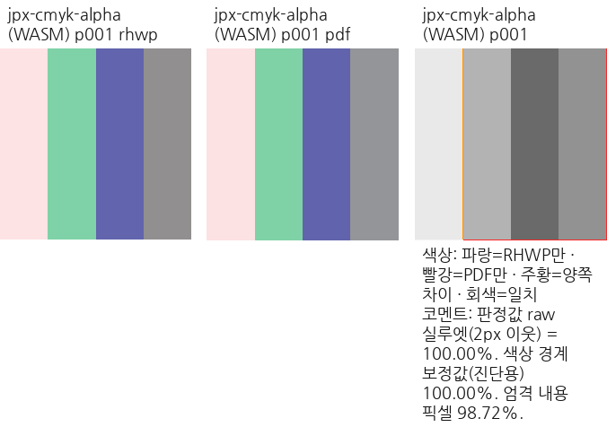

# #8174 v2-S03 — WASM 자원 정책·Worker 연결

- 승인: 2026-10-24 사용자 「다음 절편 진행을 승인합니다.」.
- 계획: [v2 구현·검증 계약](../plans/task_m100_8174_impl.md#범위-v2--기본-기능과-환경별-자원-정책).
- 시작: S02 완료 기록 commit `5b127c66e26e44377b36c023fdc9bd5a23118c59`.
- 기준: fetch한 `upstream/devel`은 `9418ed0c7cf289c5c4ac2b3bb8cdc18a1b637a9a`로 같다.
  기존 브랜치·작업을 유지하며 새 rebase는 하지 않았다. #8174는 OPEN, assignee는 edwardkim이다.
- 상태: **S03 로컬 구현·필수 검증 완료.** S02 증적의 재사용과 S03의 새 실행 결과를 구분한다.

## 선행 구현과 실제 소비 경계

| 원 해결 → 실제 반영 | 유지할 계약과 이번 보완 |
| --- | --- |
| #7911 → #7913 `4662c069e5` | 공통 IR 직접 가져오기, 현재/후보 Worker 분리, 실패한 후보의 미게시, 저장 왕복을 보존한다. |
| #7970 → `515bd72dcd` | 제품 정책을 먼저 조회하고 보이는 입력 view만 복사하며, 초기화를 포함한 하나의 deadline과 Worker 종료·재생성을 보존한다. 기존 기본 정책 cache를 요청별 프로필·한도와 혼동하지 않는다. |
| #7998 → #8120 `80968497c2` | 엄격한 sourcePages와 includeTableInference, 실제 표·문단·그림 paint와 진단·저장 보존을 유지한다. |
| #8183 → #8190 `e7a0dec55c`, S02 `5a77054519` | 기본 코덱·실제 decoder/CMM 예산·alpha·xref 복구와 독립 색 기준을 유지한다. |
| SVG 공통 자원 `7c773d5d50`·`713d39424c`, S02 | source/proof·resource key·glyph mapping·geometry guard를 보존한다. 정규화한 artwork와 Native/WASM 소비를 연결하며 Studio 실제 배치는 S04와 구분한다. |

S02의 `importPdf(data: &[u8], options)`는 generated glue가 입력을 먼저 WASM에 복사했다.
이번에는 JS typed-array 참조로 받아 Rust의 동일한 프로필·한도 확인 뒤에 복사하도록 바꿨다.
기존 `getPdfImportPolicy()` 호출은 유지하고, options를 받는 조회를 추가했다. 개별 한도는
CLI와 같은 `PdfImportPolicy::with_limits_json()`에서 해석하며 JS에서 한도 표를 복제하지 않는다.

`resourceProfile`·`resourceLimits` → 공통 정책 → 복사 전 입력 검사 →
`DocumentCore::from_pdf_bytes_with_policy` → backend/IR/조판 → 실제 진단·저장으로 추적한다.
Worker는 요청 options를 고정한 뒤 해당 정책을 조회하고, 검증한 동일 options로 가져온다.
한도·취소·deadline·trap/메모리 실패 뒤 현재 문서 보존과 다음 정상 요청을 실행한다.

## 이번 절편의 검증

- 실제 fresh WASM에서 프로필·개별 한도·엄격한 오류·선택 쪽·유효 정책/사용량을 검사한다.
- 기존 실제 Worker 테스트를 확장하고 정상 입력, 취소·deadline, 후보 메모리 실패의 폐기·재생성을 확인한다.
  fault injection과 실제 PDF의 요청 예산 실패를 구분한다. Worker 종료를 브라우저 전체 메모리 상한으로 표시하지 않는다.
- F01–F06의 WASM 출력·원본 보존·링크 결과와 공통 SVG 소비를 Native·독립 기준과 대조한다.
  실제 Studio UI·CanvasKit/host 클릭·F07/F08 연결은 승인된 S04에서 완료한다.
- 새 source의 필수 lint·전체 release-test·Native Skia·최적화 WASM·브라우저·영향 범위 시각/성능 검증을 완료한다.
  같은 절대 `target/pr-review`를 jobs 4로 순차 사용하며 대용량 debug 캐시를 새로 만들지 않는다.
- 임시 로그·원시 측정은 ignored `output/pr-review/issue8174/v2-s03-20261024/`에 둔다.
  원격 push·게시·PR 생성·게시 준비 전체 완료는 이번 단계 승인에 포함하지 않는다.

## 구현한 API와 공통 결과

| 경계 | 로컬 구현 |
| --- | --- |
| `getPdfImportPolicy()` | 기존 standard 조회를 유지한다. |
| `getPdfImportPolicyWithOptions(options)` | `resourceProfile`·`resourceLimits`를 같은 Rust 정책에서 해석한다. null·미지 키·0·음수·소수·상한 초과와 JS 정수 범위를 검사한다. |
| `importPdf(bytes, options)` | JS의 참조로 입력을 받아 옵션·한도를 확인한 뒤 보이는 Uint8Array만 fallible 예약·복사한다. Native facade의 기존 slice 인자는 조건부 type alias로 보존하며 Native에 js-sys 의존성을 추가하지 않는다. |
| Worker 세션 | options를 첫 await 전에 고정하고 매 요청의 유효 정책을 조회한다. 초기화·정책·가져오기는 하나의 deadline을 쓴다. 단계 통지와 결과 게시를 구분하고 메모리 실패·trap 후보는 폐기한다. |
| `getPdfImportRuntimeCapabilities()` | 동기 실행, host Worker 종료 요구, 복사 전 검사와 전체 process memory/sandbox 미보장을 구분한다. |
| `prepareStaticSvgRaster(optionsJson, fragment)` | Native의 정상 artwork 정규화·유한한 resvg 준비를 공통 함수로 옮겨 WASM도 같은 PNG·raw byte cost를 받는다. SVG의 `currentColor`는 실제 전경색으로 전달한다. source/proof·geometry의 기존 소비자 guard는 제거하지 않는다. |
| `classifyHyperlinkDestination(uri)` | 공통 목적지 모델의 6종 분류와 원문을 제공한다. 읽기·생성·저장과 host 실행을 구분하며 직접 실행하지 않는다. |

초기 Native 빌드에서 WASM 전용 `js_sys` 타입을 Native 서명에 직접 쓰면 안 되는 것을 확인했다.
조건부 alias로 기존 Native 인자를 보존한 뒤 Native·wasm32 library check를 모두 통과했다.
이는 producer 빌드·전체 회귀 완료와 구분한다. 컴파일과 실제 실행의 최종 source·명령·결과는
후속 절에 기록한다.

S03의 SVG 범위는 실제 WASM의 공통 raster API와 원본/출력이다. Studio CanvasKit의 준비된
자원 선택·페이지 배치·UI·host 클릭은 S04에 연결한다. 새 API의 출력만으로 Studio 표시 완료를
주장하지 않는다. WASM request policy는 CLI의 parser policy와 같지만 Linux CPU/주소 공간
감독과 같지 않으며, Worker host의 deadline은 별도로 유지한다.

## 실제 실행·시각 검증

제품 source는 `9a9329766ae8068a841795c9cb0f216c5f790c84`다. Native Skia는 238.2초,
locked wasm-pack·wasm-opt는 619.0초에 성공했다. Native SHA-256은
`2ed500697a844904c4e5c510fa2273b9cd561e1a4dede7c57f113ee43c4ad333`, WASM은
`3af77ad489908d3b65172fd6d7ab8c780148f9d4c4fe1a3b7a86b39228ac44dd`다.
같은 공용 target의 별도 release-test/release 산출물을 복사해 후속 테스트가 producer를 덮어쓰지 않게 했다.

| 실제 실행 | 결과와 경계 |
| --- | --- |
| Native·fresh WASM의 새 PDF 가져오기 | 각각 24건 성공. 20개 저장 그림은 S02 및 Native/WASM 간 픽셀 차이 0이며 나머지 네 조건은 path paint다. |
| 새 24조건·기존 #8183 17조건의 전쪽 비교 | Native·fresh WASM 각각 41조건·41쪽, raw 최저 100%, 누락·쪽수 불일치 0. |
| SVG 정상 artwork 7조건 | gradient·clip/opacity·내부 참조·제한 script 무시·내장 PNG/JPEG·전경색. 같은 원본의 Native·WASM 픽셀 차이 0, 독립 Chrome 기준 양쪽 raw 최저 100%. |
| 직접 WASM·실제 Worker 계약 | 240 assertions 통과. 일반 Worker 9개와 메모리 실패 대조 Worker 3개를 실제 생성했다. 기존 12쪽 PDF의 저장·전쪽 재열기도 유지했다. |
| 요청 예산·입력 복사 | 실제 ICC·xref 작업 한도 초과 뒤 정상 요청 성공. 8 MiB 입력을 거부할 때 WASM 선형 메모리는 5,832,704 → 5,832,704 bytes로 유지됐다. generated glue도 배열을 먼저 복사하지 않고 참조를 전달한다. |
| 목적지 | 웹·메일·문서 책갈피·상대/로컬 파일·등록 앱의 공통 분류와 실제 WASM HWP/HWPX 왕복을 검사했다. 실제 host 클릭은 S04다. |
| 기존 코덱·Worker 계약 | 19건·158 checks 통과. 실제 API 진입 후 취소·deadline과 코덱 예산 실패 뒤 복구를 보존했다. |
| source 사전 검사 | 제품 source의 14개 후보 통과. 실제 Cargo package·registry 소비·publish 성공은 아니며 S05에 남아 있다. |

[전쪽 TSV·producer manifest](../pr/assets/issue8174/v2-s03/manifest.json)와
[SVG 확대 비교](../pr/assets/issue8174/v2-s03/svg-artwork/review.png)를 보존한다.
독립 SVG는 RHWP 출력에서 만들지 않았으며 원 artwork를 Chrome SVG renderer로 그렸다.
SVG 원본·기준 source와 양쪽 TSV도 같은 디렉터리에 있다. 이는 HWP/HWPX 한컴 Print나
Studio CanvasKit 글리프 배치 검증을 대신하지 않는다.

gradient의 독립 기준 차이는 최대 1 channel, clip 가장자리의 흰 배경 합성과 alpha 차이는 최대
28이다. 완전 투명 픽셀의 미정 RGB까지 포함한 raw RGBA 차이 255와 가시 차이를 구분했다.
나머지 다섯 조건은 독립 기준과도 차이 0이다. 같은 배율의 확대 비교에서 색·연속 alpha·
clip 외곽·누락·중복과 `currentColor`를 직접 확인했다. 이 근거 뒤에 기존 Native 회귀 함수에
전경색 계약을 보완했고, 최종 suite 실행은 아래에 별도로 기록한다.

전경색은 이전 제품 source `5a77054519216f9f2dae6a779e7e334f3894466d`도 별도 checkout에서
Native 라이브러리로 빌드해 실제 replay를 대조했다. 동일한 SVG·전경색 `0x008000`의 중심은
이전 `[0, 0, 0, 255]`, 수정 후 `[0, 128, 0, 255]`였다. 독립 기준의 녹색과 대조해
**수정 전 FAIL / 수정 후 PASS**를 확인했다.
[실행 명령·source·rlib 해시](../pr/assets/issue8174/v2-s03/svg-artwork/foreground-before-after.json)와
[이전 출력](../pr/assets/issue8174/v2-s03/svg-artwork/foreground-native-before.png)·
[수정 후 출력](../pr/assets/issue8174/v2-s03/svg-artwork/foreground-native-after.png)을 보존했다.
비교 뒤 기존 공용 library alias는 바이트 단위로 복원했고, 이번에 만든 이전 source worktree만
삭제했다. S02의 base worktree와 다른 작업은 보존했다.

초기 브라우저 실행의 Chrome 경로 누락은 `VISUAL_SWEEP_CHROME`으로 보정했다.
메모리 실패 주입용 보조 Worker는 동적 module 로드 중 첫 정책 메시지를 놓쳤다. 보조 Worker의
메시지를 버퍼링한 뒤 실제 Memory.grow 실패·후보 폐기·정상 재시도를 확인했다. 이를 제품
parser의 메모리 실패나 물리 heap 상한의 입증으로 바꾸어 쓰지 않는다.

### 대표 출력과 기존 문서 보존

[대표 출력 목록](../pr/assets/issue8174/v2-s03/representatives/index.json)에 Native·fresh WASM의
ICC 간접 filter·Indexed ICC premultiplied alpha·CMYK alpha·xref 복구·200 DPI scan을
각각 compare·overlay·review로 보존했다. 같은 원본·독립 기준과 색·alpha·외곽·내용 보존을
직접 대조했다. 얇은 경계의 AA·resampling 차이는 raw 실루엣 점수와 구분한다.

일반 표 HWP와 TAC 표 HWPX는 문서별 전체 3쪽을 새 producer로 재출력했다.
기준은 `pdf/hwp_table_test-2022.pdf`와 `pdf/tac_cell_leftover_fits-2020.pdf`이며,
글꼴은 존재를 확인한 `/mnt/c/Windows/Fonts`를 S02와 동일하게 공급했다.
고정 upstream `9418ed0c7c`의 출력은 S02에서 확보한 것을 재사용했고 이번 후보 출력은 새로 만들었다.
양쪽을 모두 새로 빌드했다고 표시하지 않는다.

| 문서 | Native raw 최저 | fresh WASM raw 최저 | 같은 backend의 고정 base 대비 RGB 차이 |
| --- | ---: | ---: | ---: |
| `samples/hwp_table_test.hwp` | 96.61580% | 96.11700% | 전체 쪽 0 |
| `samples/issue6448/tac_cell_leftover_fits.hwpx` | 99.29369% | 99.30776% | 전체 쪽 0 |

[base·후보 전쪽 TSV와 결과](../pr/assets/issue8174/v2-s03/preservation/results.json)를 연결했다.
쪽수·내용·배치 후퇴가 없으며 이 대조 문서의 기존 회귀 기대값은 변경하지 않았다.

## S02 대비 성능 관측

같은 호스트의 새 탭을 package당 네 번씩 열고, 순서를 교대해 입력별 12회 실행했다.
고정 S02 package `5a77054519`와 이번 제품 source를 대조하며 OS·JIT·캐시 변동이 있는
로컬 관측으로 한정한다. 아래 first는 탭의 첫 입력이며 전 시스템의 cold 상태를 뜻하지 않는다.

| 관측 | S02 → S03 |
| --- | ---: |
| module 초기화 중앙값 | 105.25 → 103.70 ms |
| JPEG PDF 첫 가져오기 중앙값 | 214.40 → 205.25 ms |
| JPEG PDF warm 중앙값 | 32.75 → 32.20 ms |
| 일반 표 HWP 첫 열기 중앙값 | 77.65 → 77.70 ms |
| 일반 표 HWP warm 중앙값 | 14.45 → 14.10 ms |
| 선형 메모리 high-water | 양쪽 9,371,648 bytes |
| Worker 세션 첫 요청 중앙값 | 330.25 → 321.80 ms |
| Worker 세션 후속 요청 중앙값 | 139.40 → 138.95 ms |
| 최적화 WASM 크기 | 23,297,205 → 23,340,325 bytes, +43,120 bytes·약 0.19% |

Worker는 버전별 24개를 생성했다. 성공한 요청마다 새 후보를 초기화하므로 후속 요청 수치는
같은 WASM 인스턴스의 warm 재사용이 아니다. 기존 S02의 Worker source는 commit `5b127c66e2`에서
읽어 해당 S02 package와 함께 제공했다. 새 Worker와 구 bundle을 섞지 않았다.
이 두 일반 입력과 Worker 여정에서 측정상 후퇴는 관측하지 않았지만 보편적인 성능 개선·
전체 JS heap/RSS 상한·모든 문서의 무영향을 주장하지 않는다. 원시 측정은 ignored evidence의
`performance/wasm.json`·`performance/worker.json`에 보존한다.

## 최종 source의 필수 검증

회귀 source는 `4503eff0d982cfb5f108e79eb278a0be06346085`이며 제품 source `9a9329766a` 이후
`src/`·`vendor/`·`crates/`·`Cargo.toml`·`Cargo.lock`의 변경은 없다. 테스트·생성 JS·문서와
증적을 정리한 source에서 아래 20개 명령을 모두 exit 0으로 완료했다. 마지막 산출물 대조에서
발견한 `public/`의 이전 타입 선언 두 파일은 같은 producer의 선언으로 동기화해 `06bc42c98`에
기록했다. 영향받은 frontend bindings·TypeScript·전체 Node를 새 source에서 다시 통과했다.
Rust 제품 코드·JS·WASM은 바뀌지 않아 Native·WASM 빌드와 전체 회귀를 반복하지 않았다.
`CARGO_BUILD_JOBS=4`, 절대 `target/pr-review`, release-test를 사용해 Cargo를 순차 실행했다.

| 최종 검사 | 결과 |
| --- | --- |
| `cargo fmt --all -- --check` | 통과 |
| WASM·root·workspace/all-targets Clippy, `-D warnings` | 세 경로 통과 |
| `cargo build --locked --profile release-test --workspace` | 통과 |
| 정책·기본 기능·목적지 focused runner | 각각 6·9·1건 통과 |
| `cargo nextest run --locked --cargo-profile release-test --features native-skia --tests --test-threads 4 --no-fail-fast` | 11,798 PASS·기존 skip 45. 실행 1,192.231초, 컴파일 포함 명령 1,889.68초 |
| `cargo test --locked --profile release-test --features native-skia --lib -- --test-threads 4` | 본체 3,863 PASS·기존 ignored 12, workspace 15·165·2 PASS. 총 4,045 PASS |
| 필수 Native placeholder·직접 PDF·glyph replay | 각각 2·14·10 PASS |
| PDF-off `--target wasm32-unknown-unknown --no-default-features --features wasm-api --lib` | compile check 통과. 기능 비활성 runtime 검증으로 확대하지 않음 |
| suite manifest·frontend WASM bindings | 통과 |
| Studio `npx tsc --noEmit`·`npm test` | TypeScript 통과, Node 2,443 PASS·기존 skip 2 |
| 실제 최적화 WASM·Worker 최종 재실행 | 240 assertions, 일반 Worker 9·메모리 실패 대조 3. 기존 문서 유지와 다음 정상 요청 확인 |
| 코덱 실제 WASM·Worker 최종 재실행 | 19사례·158 checks 통과 |

최초 focused runner는 테스트 소스의 행 수 변경 뒤 파생 suite를 갱신하지 않아 0건·exit 4였다.
이를 PASS로 세지 않았다. `node scripts/rust-test-suite-manifest.mjs --prepare`로 1,745 sources·
7,655 static attributes·28 harnesses·20 exceptions·48 integration targets를 재생성한 뒤
영향받은 all-target Clippy와 focused 검사, 전체 suite를 실행했다. 변경 없는 앞선 성공 검사는
동일 source·명령을 확인해 유지했다. 기존 테스트 기대값·baseline·CI 호출을 완화하지 않았다.

브라우저 runtime JSON의 기존 `visualJudgment` 필드는 시각 gate가 아니다. 이번 시각 판정은
별도 Native/fresh WASM 전쪽 TSV·대표 PNG의 직접 판독으로 기록했다.
실행 명령·cwd·소요 시간·producer 해시·검사 수는
[최종 검증 집계](../pr/assets/issue8174/v2-s03/validation.json)에 보존한다.
원시 로그는 `output/pr-review/issue8174/v2-s03-20261024/`에 있다.

S04의 Studio 실제 열기·CanvasKit·host 클릭·F07/F08, MD05의 나머지 감사,
S05의 실제 14개 graph 포장·독립 소비는 계속 남아 있다. S03 완료를 범위 v2 전체의 완료나
비신뢰 PDF 안전성 보증·crates.io 게시 준비 완료로 확대하지 않는다.
