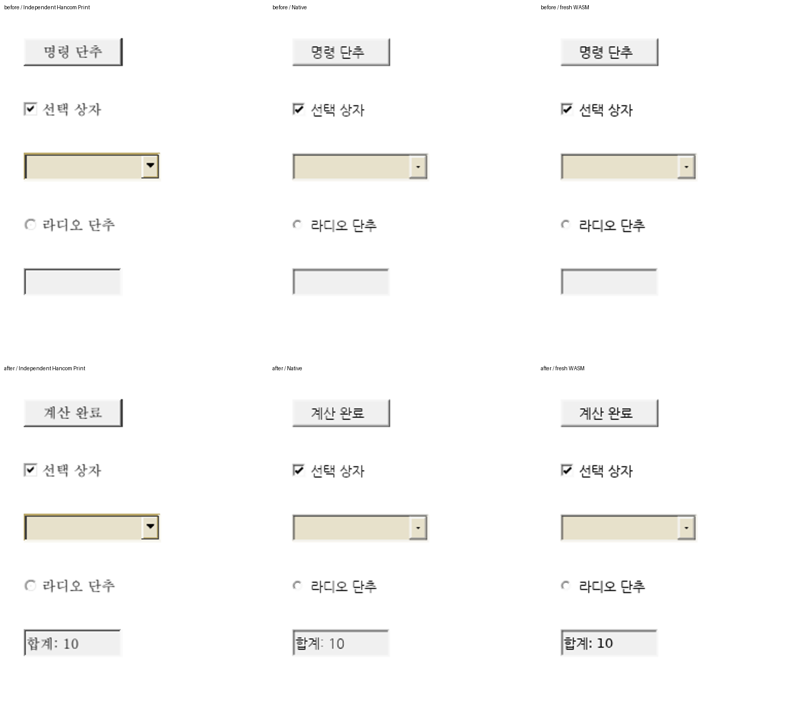

# #8174 v2-S04 — Studio 기본 기능·보호 복구

- 승인: 2026-10-25 사용자 「다음 절편 진행을 승인합니다.」.
- 계획: [승인한 v2 계약](../plans/task_m100_8174_impl.md#범위-v2--기본-기능과-환경별-자원-정책).
- 시작 head: `485565e95d`. S03의 변경·검증은 커밋된 상태이며 작업 트리는 깨끗했다.
- 기준: 새 fetch의 `upstream/devel`은 `9418ed0c7cf289c5c4ac2b3bb8cdc18a1b637a9a`로 같다.
  #8174는 OPEN이고 edwardkim에게 할당돼 있다. 기존 작업 브랜치와 공용 target을 유지한다.
- 상태: S04 로컬 구현·필수 검증 완료. 최종 제품 source는 `e6d7b774c1`이다. S05·MD05의 나머지 감사와 원격 게시·PR 생성·실제 crate 게시는 남아 있다.

## 선행 계약과 실제 변경 경계

| 항목 | 선행 구현 → 현재 소비 → 이번 작업 |
| --- | --- |
| PDF | #7911/#7913·#7970·#7998/#8120 → S03의 공통 `PdfImportSession`·요청 정책. Worker는 inspect/render/export만 제공한다. Studio의 전체 편집 API를 대체하지 않고 성공한 후보를 직렬화·재열기한 뒤 원자적으로 교체한다. 실패·취소는 기존 문서·draft·recent 연결을 보존한다. |
| SVG | S02/S03의 공통 정규화·bounded raster API와 독립 artwork 대조 → Studio CanvasKit의 path 전용 후보 선택을 실제 공통 raster 소비에 연결한다. source/proof·geometry guard와 대체 표시의 소유 계약을 보존한다. |
| 링크 | S02/S03의 공통 6종 목적지 분류·원문/저장 보존 → 실제 사용자 클릭·내부 이동·host 위임·브라우저 안내로 연결한다. 문서 열기만으로 외부 동작을 실행하지 않는다. |
| 명령 단추 | 보존된 `FormObject.properties`·Scripts 원본 → 공통 action 조회·제한된 실행 계획 → 기존 편집 dispatcher/undo. 실제 양식의 업무 동작과 무한 반복·초과·보호 상태·실패 후 편집을 검사한다. 무제한 eval·shell 실행은 사용하지 않는다. |
| 보호 복구 | #5992 → 원 PR #6019 → 통합 #6076 `6240d255bbb48e2d7c6823fe8141967b4db179ae`. 평문 exporter 이전 차단·debounce/disabled·상태바 복원이 기존 계약이다. 인증 암호화 envelope로 기능을 확대하며 평문 차단·원래 저장 보호 의도는 보존한다. |

#5992 본문·전체 댓글·#6019/#6076 본문과 현재 autosave 경로를 대조한다. 지원 HWP의 암호 저장은
인증 태그를 제공하지 않으므로 복구본의 인증 암호화 요구를 그 저장 형식만으로 충족했다고
표시하지 않는다. 복구 전용 키를 메모리에만 두고 재시작 때 암호로 다시 해제하는 envelope를
사용한다. 암호·키를 draft·최근 문서·URL·로그에 저장하지 않는다.

## 구현·검증 순서

1. PDF 후보의 공통 정책·입력 크기·전체 deadline과 Worker/직렬화/재열기 수명을 연결하고,
   프로필·유효 한도·진행·취소·재시도를 실제 열기 UI에 반영한다.
2. 정상 SVG artwork와 링크의 실제 CanvasKit·사용자 클릭 경로를 연결한다.
3. 실제 보존된 양식 script/action과 제한된 runtime을 연결해 업무 동작·undo·실패 복구를 검증한다.
4. 보호 복구 envelope·키 수명·원자적 저장/삭제·재시작 해제를 구현하고 오입력·변조·비밀번호 변경·
   문서 교체·저장 중 폐기 경합을 검사한다.
5. 영향받은 focused 검사 → 최종 source의 필수 lint·전체 회귀·Native·최적화 WASM·Node/TypeScript·
   실제 Studio 브라우저·전쪽 시각/성능 검증을 완료한다. S03 producer 재사용과 새 실행을 구분한다.

임시 실행 로그·JSON·화면은 `output/pr-review/issue8174/v2-s04-20261025/`에 보존한다.
Cargo는 같은 절대 `target/pr-review`, jobs 4로 순차 실행한다. source·WIP·기존 worktree·target은
임의 삭제하지 않는다. S04의 필수 항목을 후속 이슈로 옮겨 완료를 대신하지 않는다.

## 구현 고정 전 확인

- Studio 전체 Node 검사: 2,457 PASS, 기존 skip 2. TypeScript 통과.
- Rust root·WASM Clippy `-D warnings`와 새 action 조회·변경의 Native focused 4건 통과.
  fmt 뒤 파생 suite를 다시 생성하지 않은 최초 실행은 0건·exit 4였으므로 성공으로 세지 않았다.
- PDF 파일 입력 → constrained 정책 → 실제 Worker → HWPX 재열기 → CanvasKit 표시를
  기존 S03 WASM과 새 Studio 코드에서 먼저 확인했다. 새 S04 producer의 최종 검증과 구분한다.
- 사용자는 현재 구현된 업무 단추·검증 문서가 없다고 답했다. 실제 한컴 생성 양식의 배치와
  Click 원본 저장 형식을 유지한 계산 대조군으로 동작을 검증한다. 이 자료를 기존 사용자 업무의
  호환성 검증으로 표시하지 않는다. 무제한 JScript 호환도 주장하지 않는다.
- 한컴 변환 서비스는 `scripts_disabled`로 script를 제거한다. 해당 서비스의 Print는 동작 전후
  정적 화면 대조에만 사용하고 한컴에서 Click 실행·script 보존을 입증한 것으로 보고하지 않는다.

PDF deadline은 편집 문서 재열기 후 원자적 교체 직전에도 검사한다. Worker 종료는 중단 가능하지만
main thread의 동기 재열기 자체를 중간에 선점하지는 못한다. 초과 후보는 게시하지 않는다.

## 실제 실행에서 발견한 저장 경계 보정

새 WASM의 실제 클릭은 계산 결과·체크 상태·캡션·undo/redo와 HWP 저장을 통과했으나,
HWP → HWPX 저장 후 Click 원본이 없어지는 실패를 검출했다. 최초 전체 검증은 이 발견 뒤
중단했고 성공한 일부 검사를 최종 검증으로 승격하지 않는다. 최초 producer와 실패 로그는
`before-correction-native/`, `before-correction-wasm/`, `browser-forms.log`에 남겼다.

선행 #3557의 원 해결 `f04dc03b8a` → 반영 `84ad0e5b56`은 HWPX 원본의 `Scripts/*`와
content.hpf 참조를 보존한다. #7426 `97073606de`의 후속 content 수정에서도 이 통과 경로는
유지된다. 기존 `issue_3557_package_preservation`은 원래 HWPX의 바이트 보존을 검사하며,
HWP의 `Scripts/DefaultJScript`를 표준 HWPX script parts로 바꾸는 경로는 없었다.

원인 계층인 공통 형식 변환을 보정했다. 제한된 counted UTF-16/deflate 해석을
`model::form_script`로 공유하고 action 조회·기존 ComboBox 조회·HWPX 변환이 이를 소비한다.
HWPX 원본의 script 바이트는 계속 그대로 통과시키며, HWP 원본은 표준 header/source parts와
manifest·spine 참조를 함께 생성한다. 손상·초과 script의 조용한 누락으로 성공시키지 않는다.
수정 후 Native focused 5건이 실제 실행됐다. 새 전체 검증과 producer 재빌드는 별도로 진행한다.

읽기 전용 host가 단추 실행을 철회하는 API를 추가해 시작과 반영 직전에 검사한다.
PDF 확장자가 바뀐 파일도 1 KiB header만 먼저 검사하고, 정책 선택 전에 전체 파일을 읽지 않는다.

키 도출 중 새 문서가 열리는 경합도 확인했다. 일반 보호 열기와 복구 열기 모두 이전 세대의
후보를 게시하지 않게 검사하며, 실제 Web Crypto 호출 앞의 결정적 대기 gate에서 새 문서를
만든 뒤 해제하는 브라우저 검사 3건이 통과했다. 소비하지 않은 암호화 draft도 보존했다.
현재 Studio 전체 Node는 2,458 PASS·기존 skip 2이며 TypeScript와 배포 빌드가 통과했다.

새 최적화 WASM의 실제 단추 검사에서 HWP/HWPX 양쪽 저장·재열기와 원본 script 보존을
확인했다. 새 문서 생성 경로에는 `document-swapped`가 빠져 Worker가 deadline까지 남는
실패가 있어 같은 교체 알림을 연결했다. 구독자 세 곳(표 resize cache·field event·단추 취소)을
대조했고 실제 새 문서 생성·취소 뒤 일반 편집까지 23개 브라우저 assertion이 통과했다.

암호 저장 반복 검사에서 모달이 열린 동안 편집기 focus가 돌아와 입력이 본문에 들어가는
실패도 발견했다. 무해한 검사 문자열과 실제 활성 편집기로 수정 전의 포커스 이동·문서 변경을
재현했다. #3414/PR #4708의 `d2c5e326a4f` → `d15b63eb46`은 마지막 모달 종료 후 복원을
추가했으며 열린 모달 중의 편집기 focus 재진입을 막지는 않았다. 기존 복원 계약과 중첩 모달을
유지하면서 공통 focus 경계·최상위 모달의 키 소유·암호 입력의 초기 focus를 보정했다.
수정 후 본문 불변·암호 입력 focus·자식/부모 입력 4건과 보호 저장/키 변경/경합 8건을 확인했다.
정식 `e2e/issue8174-modal-focus.test.mjs`도 기존 E2E helper로 4건 통과했다.
Node 전체 2,458 PASS·skip 2와 TypeScript를 다시 통과했다. Rust 제품 코드는 그대로이므로
진행 중인 Rust 전체 검증은 유지하며 변경한 frontend를 새 head에서 별도로 검증한다.

#3557의 PR 연결도 확인했다. 원 PR #4958의 script 보존을 통합 PR #4965
`88b44de37b491a47494d2acac708b7b86a082951`가 수용했다. 앞서 확인한 원 커밋과 통합 내
`84ad0e5b56`, 기존 바이트 보존 검사와 현재 HWP-origin 확장 검사를 구분한다.

## 1차 고정 source와 제품 경계

| 실행 대상 | 정확한 source | 설명 |
| --- | --- | --- |
| 공통 Rust·Native producer | `d329bb309bde593e45e952b0e14ddd46a02b7c62` | script 해석·양식 주소/갱신·HWP → HWPX script 보정 뒤 빌드 |
| 최적화 fresh WASM | `03e31d5b20b9f765655d5c30bb97e659caa50ca9` | locked wrapper·wasm-opt 사용. `pkg/`와 Studio public의 4개 파일이 동일 |
| 전체 Rust gate | `3d021f944d841807fd35093e2210ae93c1743c96` | Rust 제품 코드는 위 producer와 같다 |
| 최종 Studio 소비 | `40b7b2937b399e21b13e8723843ec8daa8fcbb09` | 공통 모달·암호 입력 focus 보정 뒤 TypeScript·Node·배포·브라우저 재검증 |

이 source 사이의 `src/`·`vendor/`·`crates/`·Cargo manifest/lock은 같다. Rust 검증 뒤의
TypeScript 보정에는 frontend 검증을 다시 적용했고, 같은 Rust의 전체 검증을 중복 실행하지 않았다.
이후 문서·증적 커밋도 제품 source를 바꾸지 않는다.
[producer 해시](../pr/assets/issue8174/v2-s04/metadata/first-candidate-wasm-producer.json)의 1차 최적화 WASM은
23,306,727 bytes, SHA-256 `aceb2af17d34839a833414f1e1af0a50708956df26a28acaaf50c5bd970e1596`다.

| 기능 | 생산 결과 → 실제 소비 → 최종 반영 |
| --- | --- |
| PDF | 공통 `PdfImportPolicy` → `preparePdfForEditor`의 실제 Worker·HWPX export → `WasmBridge.loadImportedPdf`의 쪽수/deadline 검사·후보 교체. Worker는 성공/실패 모두 종료한다. 기존 문서 상태는 최종 성공 때만 바뀐다. |
| SVG | 공통 `prepareStaticSvgRaster` → CanvasKit `staticSvgGlyphRaster`의 source/proof/hash·viewBox/fontEmBox/currentColor → 실제 glyph transform과 paint. Native와 별도 SVG 규칙을 만들지 않는다. 공통 API가 없는 구 producer만 이전 path fallback을 사용하며, 예산 실패 때 제한을 우회하지 않는다. |
| 링크 | 공통 Rust 목적지 분류 → 실제 hyperlink hit와 세대 확인 → 내부 책갈피·opener 분리 창·host handler/브라우저 안내. 비동기 host가 문서를 바꾸면 이전 링크의 visited 편집을 새 문서에 적용하지 않는다. |
| 단추 | CFB/HWPX 보존 script → 공통 bounded decoder와 주소가 포함된 action context → 제한된 data-only Worker 계획 → 실제 양식/본문 편집을 한 SnapshotCommand로 반영. 전체 갱신 검증 전에 일부 값을 쓰거나 잘못된 주소를 본문으로 대체하지 않는다. |
| 복구 | UI 암호와 세션 전용 키 → 인증 암호화 후 IndexedDB 저장 → 재시작 재인증·기록 동일성/문서 세대 검사 → 성공 후보 게시와 소비한 draft 삭제. 보호된 상태에 키가 없으면 평문 exporter 이전에 차단한다. |

## 실제 브라우저·저장 검증

최종 consumer에서 실제 Worker·최적화 WASM·CanvasKit·IndexedDB·편집 history를 사용했다.
[runtime 원본](../pr/assets/issue8174/v2-s04/runtime/)에 assertion과 적용 경계를 남겼다.

| 범위 | 확인한 실제 결과 |
| --- | --- |
| PDF 14개 assertion | 확장자가 바뀐 PDF의 1 KiB header 선검사·입력 cap 전 전체 읽기 0회. 정책 전 취소/실패·시간 초과·진행 중 취소에서 기존 문서/draft/recents/handle 보존. standard/constrained 유효 정책·Worker 종료·편집·HWPX 재열기 통과 |
| 단추 23개 assertion | 실제 mouse click으로 합계 10·체크 1·캡션 변경. 원자적 undo/redo, HWP와 HWPX의 값 3개·원본 script 보존. 무한 반복/timeout/cancel·후속 요청·readonly·양식 모드·본문 삽입/undo·busy·새 문서 교체 뒤 Worker 종료와 일반 편집 통과 |
| 링크 11개 assertion | 자동 실행 없음, 메일·등록 앱 host, 실제 책갈피 이동, 상대/로컬 파일·앱 주소 안내, popup 차단 안내/opener 분리, 실제 다른 HWP 열기 뒤 stale 링크 편집 방지·host 오류 안내 통과 |
| 보호 복구 14개 assertion | 실제 IndexedDB 암호문·암호 DOM 제거·암호 영구 저장 없음. 브라우저 프로세스 재시작 뒤 오입력/취소/정상 복구·실제 편집 내용·보호 저장 의도 보존·nonce/revision 갱신·변조·삭제 경합 통과 |
| 보호 저장/경합 8개 assertion | 실제 암호화 HWP export를 fake FS sink로 캡처. 저장 취소/두 종류 쓰기 실패는 기존 키 유지, 성공 때만 키 교체. 변경 암호로 저장본·새 draft 해제, 저장 중 문서 폐기와 키 없는 평문 exporter 차단 통과 |
| 키 도출/교체 경합 3개 assertion | 실제 Web Crypto 앞의 결정적 대기 중 새 문서 생성. 일반 보호 열기·복구가 새 문서를 덮어쓰지 않으며 미소비 draft 보존 |
| 배포 빌드 6개 assertion | dev global 없이 실제 PDF Worker·단추 Worker·공개 Save·HWP 재열기 통과. HTTP로 제공한 두 WASM 응답이 고정 producer 해시와 일치하고 page error 0개 |
| 모달 E2E 4개 assertion | 기존 E2E helper로 편집기 focus 재진입 방지·본문 불변·자식/부모 입력 소유 확인 |

정상 흐름은 실제 구현을 실행했다. timeout/cancel 검사는 실제 Worker의 owner postMessage를
조용히 만드는 주입이며, KDF 경합은 실제 Web Crypto 앞의 대기다. 메일 전송·설치된 OS 앱의
최종 실행을 이 host callback 검사로 입증하지 않는다. 실제 사용자 저장 파일도 덮어쓰지 않았다.

[재현 절차와 제어된 fixture](../pr/assets/issue8174/v2-s04/README.md)를 정식 경로에 보존했다.
개인 절대 경로를 환경 변수·저장소 루트로 바꾼 스크립트도 모두 재실행했다.
같은 41개 matrix의 Worker/직접 경로/고정 증적 PNG는 RGBA가 모두 같다.

## 전쪽 시각 검증과 직접 판독

[TSV 원문·해시·최솟값](../pr/assets/issue8174/v2-s04/visual-summary.json)을 byte 그대로 보존했다.
PDF 변환은 이미지·색·alpha·xref 복구의 독립 기준을 사용하며, 기존 #8183의 두 alpha Print
결함에 대한 메인테이너 결정은 해당 입력에만 유지한다. 이번 모든 문서를 한컴 Print로 만들었다고
표시하지 않는다. 단추의 전후 정적 화면만 새 독립 한컴 Print로 대조했다.

| 범위 | Native raw 최저 | fresh WASM/실제 Studio raw 최저 | 전체 쪽·직접 확인 |
| --- | ---: | ---: | --- |
| PDF 41개 | 100% | fresh WASM·Studio 각각 100% | 입력마다 한 쪽. 실제 Worker HWPX를 동일하게 소비. ICC 간접 filter·Indexed ICC premultiplied alpha·CMYK alpha·xref·200 DPI scan을 양쪽 compare/overlay/review로 직접 판독 |
| 단추 동작 전 | 96.98675% | 96.93730% | 독립 Print·Native·WASM 모두 한 쪽 |
| 단추 동작 후 | 97.42445% | 97.34453% | 계산 값·체크·캡션·앞뒤 본문·컨트롤 포함/겹침 확인 |
| SVG 7개 artwork | 100% | 100% | 독립 authored SVG/Chrome 기준. CanvasKit transform 1개도 100% |
| 일반 표 HWP 전체 3쪽 | 96.61580% | 96.11700% | S03 대비 각 backend의 전쪽 RGB 차이 0, TSV도 동일 |
| TAC 표 HWPX 전체 3쪽 | 99.29369% | 99.30776% | S03 대비 각 backend의 전쪽 RGB 차이 0, TSV도 동일 |

단추의 원본은 실제 한컴 생성 `samples/form-02.hwp`다. CFB stream 9개를 대조해
`Scripts/DefaultJScript`와 FileHeader bit 3 외에 레이아웃 원본이 바뀌지 않았음을 확인했다.
동작 뒤 Studio의 실제 저장본과 Print 입력도 byte가 같다.
[입력 생성·stream 해시·Print 출처](../pr/assets/issue8174/v2-s04/fixtures/provenance.json)에 연결했다.
한컴 서비스의 `scripts_disabled` 전처리를 우회하지 않았으며 정적 Print와 Click 실행 증거를 구분했다.

전후 양식의 확대 판독에서는 한컴 원본 `한컴바탕`과 현재 공급 가능한 글꼴의 자형 차이 및
classic control 외관 차이가 남는다. 존재하는 Windows 글꼴 경로를 실제 공급하고 face 이름을
대조했으며 `HCR Batang/함초롬바탕`을 `한컴바탕`과 같은 face로 취급하지 않았다.
계산 값·캡션의 누락/잘림·순서 변화·컨트롤 겹침은 없고 전후 같은 글꼴 계약을 유지한다.
100% 조판 일치를 주장하거나 글꼴 예외로 판정을 대신하지 않는다. 이 페이지는 98% 미만이므로
절대 px 좌표·전체 SVG hash를 새 회귀 기대값으로 고정하지 않았다.

PDF 직접 열기와 Worker의 실제 CanvasKit PNG는 41개 RGBA가 같다. Native와 CanvasKit 사이의
미세 raster 차이와는 구분한다. 200 DPI scan은 표 경계·본문 위치·자간/행간을 같은 배율에서
직접 대조했고 filtering/AA 차이 외의 새 누락·배치 변경은 보이지 않았다.
SVG는 gradient 색 변화·clip 경계·opacity·내부 참조·내장 이미지·전경색·transform을 직접 확인했다.
위반 proof/resource/geometry는 glyph 후보를 거부하고 기존 텍스트 대체를 사용한다.

## 최종 gate 집계

아래 1차 실패·보정 이력과 마지막 「최종 source의 완료 판정」을 구분한다. 최종 판정은 보정 source의 전체 재실행 결과다.

### 전체 회귀에서 검출한 배포용 script envelope 보정

첫 전체 실행은 11,803건 중 11,799 PASS·4 FAIL·기존 skip 45였다. 실패는 모두 #5128의 같은
공개 사양 HWP가 HWPX 저장 전에 `FORM_ACTION_INVALID`로 중단된 것이다. 진행 중 일부 tail만
보고 실패가 없다고 안내한 내용을 정정한다. 이 실행을 전체 통과로 세지 않는다.

선행은 #5128 → 원 PR #5498 head `1a7eeea074eee7046cd4944c2f2cfed2f6f0618f` →
메인터너 통합 #5530 `bef280b001` → #7696 `ecaad39adf`의 기존 배치 계약을 확인했다.
S03은 같은 검사의 전체 통과를 기록했고, 이번 실패는 조판 assertion 전의 저장 오류다.
원본·쪽수·줄/표 소유 검사와 기대값은 유지한다.

사양 4.2.13은 배포용의 stream에 `HWPTAG_DISTRIBUTE_DOC_DATA` 256바이트 레코드가
존재함을 규정한다. 실제 `Scripts/DefaultJScript`는 이 header를 가진 420바이트이며,
기존 bounded crypto helper로 272바이트·79자 header와 47자 source가 정상 해제됐다.
새 decoder가 이 유효 형식을 raw deflate로 가정한 것이 이번 회귀의 원인이다.

같은 공통 script decoder에서 정식 envelope를 식별하고 기존 `decrypt_viewtext_section_limited`
결과를 소비한다. 저장 입력·복호/해제 결과의 1 MiB 한도를 유지한다. 편집 전환이 문서의
배포용 flag를 먼저 지워도 stream의 실제 envelope 계약을 읽는다. 손상 입력을 조용히 버리거나
파일별 예외로 우회하지 않는다. 새 검사는 공개 원본의 header/source UTF-16 보존만 확인하며
조판 픽셀·쪽수 기대값을 새로 추가하지 않는다. 이전 4개 검사도 수정 없이 다시 실행한다.
이 수정으로 Rust source가 바뀌었으므로 새 producer·필수 gate·실제 브라우저·시각 결과를
확인한 뒤 완료 여부를 판단한다. 위 최초 producer 결과와 새 실행은 구분한다.

보정 source `e6d7b774c1437ad502a1e702bf8f01f2b6541c28`에서 단추·script 6건과 기존
#5128의 5건이 모두 통과했다. 기존 검사의 기대값은 바꾸지 않았다. 새 전체 실행·producer와
브라우저·시각 검증을 진행하며, 최초 원시 증적은
`output/pr-review/issue8174/v2-s04-20261025-before-distribution-correction/`에 보존한다.

## 최종 source의 완료 판정

공통 Rust·Native·최적화 WASM·Studio 소비를 모두 `e6d7b774c1437ad502a1e702bf8f01f2b6541c28`에서 다시 실행했다.
위 시각 결과표의 수치도 이 source에서 동일하게 확인했다. 최초 4개 실패는 기대값 변경 없이
복호/압축 해석 경로에서 해결했으며, 최종 전체 회귀의 성공으로 대체한다. 테스트·baseline·CI
호출을 완화하거나 실패 검사를 제거하지 않았다.

새 WASM은 23,453,911 bytes이며 SHA-256은
`d4f9e4313ae35f762130f3a4a845d62d90bb4357582529f83d74c7e64397f915`다.
생성 선언의 `version`·`init_panic_hook` 순서만 바뀌었고 runtime JS는 같다.
[선언/산출물 대조](../pr/assets/issue8174/v2-s04/metadata/generated-declarations.json)와
[최종 실행 집계](../pr/assets/issue8174/v2-s04/validation.json)에 실제 파일 해시·명령·source를 남겼다.

| 최종 gate | 결과 |
| --- | --- |
| fmt·WASM/root/workspace all-target Clippy·workspace build | 모두 exit 0 |
| 단추/script·기존 #5128 focused | 6·5 PASS |
| 전체 Native nextest | 11,804 PASS·기존 skip 45. `Summary [1199.844s] 11804 tests run: 11804 passed (8 slow), 45 skipped` |
| Native Skia lib | 총 4,045 PASS. 본체·workspace별 수와 기존 ignored는 실행 집계 참조 |
| Native placeholder·직접 PDF·glyph replay | 각각 2·14·10 PASS |
| PDF-off WASM compile·suite manifest·frontend bindings | 모두 통과 |
| Studio TypeScript·전체 Node·배포 빌드 | TypeScript·build 통과, 2,458 PASS·기존 skip 2 |
| fresh 제품 WASM/Worker | 240 assertions·실제 Worker 12개, 코덱 19개 사례·158 checks 통과 |
| 실제 Studio·배포·모달 | 브라우저 스크립트 11개·정식 모달 E2E 4개 assertion 통과 |
| 시각·보존 | TSV 원문 146개, 독립 기준 전체 쪽수 일치·90% 미달 없음·대표 확대 판독 완료 |

새 실제 저장본의 DocInfo가 1차 파일과 달라 옛 Print를 재사용하지 않았다.
현재 입력 `d480cf90aff4cbb2e2fd063d1094a93b387bfbf3aebe4cefb915be374df63c4d`에 대응하는
새 [독립 Print](../../pdf/issue8174/studio/button-after-s04-2020.pdf)를 확보했다.
이전 Print와 대응 입력도 이력으로 함께 보존한다. 최종 형식·쪽수·raw 수치는 위 결과표와 같다.

## S03 대비 성능과 비용

필수 Cargo gate가 모두 끝난 뒤 같은 호스트에서 새 탭을 package당 네 번 열고 순서를 교대해
입력별 12회 측정했다. first는 탭의 첫 입력이며 시스템 전체 cold cache를 뜻하지 않는다.
Worker 비교는 같은 최종 producer의 기존 직접 열기와 새 Worker·직렬화·재열기 경로다.
입력 업로드·UI 대기·렌더링 시간은 가져오기 시간에 섞지 않았다.
[원시 측정·환경·요약](../pr/assets/issue8174/v2-s04/performance/summary.json)을 연결한다.

| 관측 | S03 → S04 |
| --- | ---: |
| module 초기화 중앙값 | 107.00 → 109.35 ms |
| JPEG PDF 첫 가져오기 | 213.35 → 217.40 ms |
| JPEG PDF warm | 33.00 → 32.60 ms |
| 일반 HWP 첫 열기 | 82.45 → 82.85 ms |
| 일반 HWP warm | 14.20 → 14.00 ms |
| 선형 메모리 high-water | 9,371,648 → 9,437,184 bytes |
| 최적화 WASM 크기 | 23,340,325 → 23,453,911 bytes, +113,586 bytes·+0.49% |

같은 S04에서 직접 열기 → Worker handoff의 first 중앙값은
145.00 → 195.40 ms,
후속 요청은 37.20 → 152.60 ms다.
Worker의 초기화·변환·직렬화와 main 재열기의 중앙값은 각각
152.50·7.05 ms다.
매번 새 Worker를 만들므로 후속 요청도 같은 WASM 인스턴스의 warm 재사용은 아니다.
중단 가능한 가져오기와 기존 문서 보존을 위해 이 직렬화·재열기 비용을 지불한다.

복구 키 최초 도출 중앙값은 235.45 ms다.
64 KiB·1 MiB의 반복 AES-GCM protect 중앙값은 각각
0.10·2.00 ms이며,
해제는 KDF를 포함해 236.15·239.05 ms다.
키 도출은 열기·암호 변경·재시작 복구 때 수행하고 반복 autosave는 세션 키를 재사용한다.
이 값은 HWP 직렬화·IndexedDB 전체 비용이나 모든 크기의 지연을 뜻하지 않는다.
SVG 7개는 cold/warm 실제 렌더링을 나눠 측정했고 cache가 각 1개·900 pixels를 유지했다.

이 측정 입력의 관측값과 새 기능의 비용을 구분하며 모든 문서의 성능 무영향·전체 브라우저
RSS 상한을 보장하지 않는다. 성능을 이유로 승인한 기본 기능을 다시 opt-in으로 바꾸지 않았다.

문서 상대 링크는 640개 문서에서 통과했다. 변경한 장기 문서 7개의 metadata 오류는 0개다.
전역 metadata의 기존 오류 20개·5개 파일은 시작 source와 byte가 같으며 새 오류는 없다.
[검사 범위·기존 오류 분리](../pr/assets/issue8174/v2-s04/metadata/document-metadata-final.json)에 기록했다.

## 남은 절편

S04의 필수 로컬 항목은 완료했다. 다음은 승인한 v2의 S05: 현행 14개 후보의 실제 포장·독립
Rust/CLI/WASM 소비·가이드와 최종 게시 인계다. MD05의 나머지 보안 감사·격리 검증과
미결정 MD01·MD08·MD09를 완료하기 전에는 비신뢰 PDF의 공식 안전성 보증이나 crates.io
게시 준비 전체 완료를 선언하지 않는다. 이번에는 원격 push·PR·comment·실제 게시를 하지 않았다.
