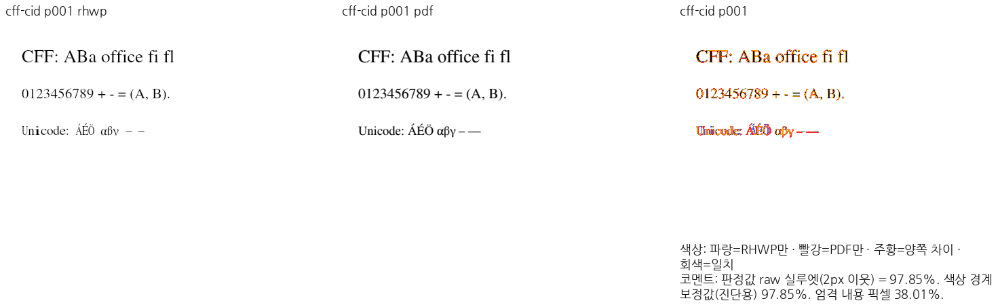
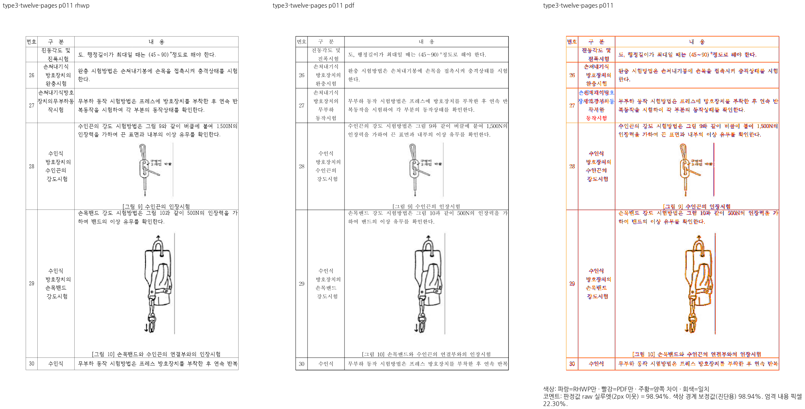

# #8174 v2 S07 — Type1/CFF 확장과 Unicode memo 예산 보정

- 승인: 2026-10-25 사용자 「다음 절편 진행을 승인합니다.」.
- 범위: [S06의 P0 보정 순서](task_m100_8174_v2_stage6.md#보정-순서와-완료-조건) 중 B01·B02.
- 시작 source: `4e2149dc65bdbc15413bf09d710c85882260e2ae`.
- 고정 base: `9418ed0c7cf289c5c4ac2b3bb8cdc18a1b637a9a` (`upstream/devel`, fetch 확인).
- 검증 code head: `0ca4dac5000e7fb888879fcac168376d0a9d4a2f`.
- 판정: **B01·B02의 계상 보정과 실행 검증은 통과했다. 확대 판독에서 기존 PDF 문자 폭·줄바꿈
  결함을 확인해 시각 완료·PR 제출 판정은 보류한다.** 전체 MD05 감사 완료로 확대하지 않는다.

## 변경 계약

[S06](task_m100_8174_v2_stage6.md)의 원 해결 PR·통합·후속 보정 이력과 현재 호출 경로를
이어받는다. 기존 TrueType 예약, 제한 요청의 전역 cache 우회, 같은 문서의 FontInfo Arc 공유와
요청 간 예산 분리는 유지한다. B03·B04의 나머지 font/cache payload·frontend/Core 할당과
B07의 실제 confinement를 이번 B01·B02 완료로 대신하지 않는다.

| 경로 | 보정 |
| --- | --- |
| Type1 encoding | glyph name을 빌려 읽고 map 삽입 전에 요청 예산과 fallible reserve를 적용. 같은 코드의 덮어쓰기도 작업량으로 계상 |
| CFF | Name/Top DICT/String INDEX, charset, encoding·simple/CID map의 생성 전에 같은 요청 예산을 전달. INDEX offset의 1-based 규칙·범위·overflow와 DICT operand 48개 상한을 검사 |
| glyph name | embedded post/charset 이름 Vec와 실제 String을 OnceLock에 넣기 전에 예약·계상. 저장된 이름을 읽을 때도 sticky 오류 확인 |
| Unicode memo | 양성·음성 miss의 entry, 반환 문자열, memo 보관용 복사와 cache hit 복사를 계상. 실패 뒤 cached 문자를 성공으로 반환하지 않음 |
| 문자 fallback | CMap range·표준 encoding·CJK byte decoder·radical 정규화에 같은 String 예약 경로 적용. Shift-JIS의 작은 임시 Vec/String은 고정 stack buffer로 대체 |

기존 공개 Type1/CFF 함수의 호출 형태는 유지하고 budget 변형을 추가했다.
`FontInfo::from_dict`는 원래 PdfDocument의 요청을 전달한다. 예산 없는 legacy 호출을 자동으로
제한 요청으로 바꾼 것은 아니다. 카운터는 누적 예약·확장 작업량이며 allocator overhead,
live heap·프로세스 RSS의 증명으로 해석하지 않는다.

독립 계약은 [Adobe CFF 명세 §4–5](https://adobe-type-tools.github.io/font-tech-notes/pdfs/5176.CFF.pdf)의
operand와 INDEX 규칙, TrueType post Format 2 이름, 알려진 CJK encoding의 문자 대응을 따른다.
새 검사는 작은 합성 자원 계약이며 한컴 조판 golden·px 기준값이 아니다.

## 자원 계약과 실패 후 복구

새 정식 자원 계약 11개는 Native focused 실행에서 통과했다. CFF charset이 들어간 뒤 output map
예약에서 실패하는 경계, memo hit의 정확한 1바이트 복사 경계, negative memo, compressed CMap
range, embedded post, FontMatrix 실수 문자열과 6종 CJK fallback을 포함한다.
새 파일은 [`tests/cases/issue_8174_font_resource_limits.rs`](../../tests/cases/issue_8174_font_resource_limits.rs)에
두었고 기존 자동 수집 suite로 실행했다. CI workflow에 중복 호출을 추가하지 않았다.

| 실행 | 결과 | 보존 증거 |
| --- | --- | --- |
| 기존 공개 API로 실행 가능한 수정 전 계약 6개 | 6개 모두 FAIL. 기존 memo·glyph-name 경계의 누락을 재현 | [before](../pr/assets/issue8174/v2-s07/before-font-contracts.json) |
| 수정 후 정식 계약 11개 | Native 11 PASS, 실제 wasm32 모듈 11 PASS | [Native](../pr/assets/issue8174/v2-s07/candidate-font-contracts.json), [WASM](../pr/assets/issue8174/v2-s07/wasm-font-contracts.json) |
| 실제 CLI, `fontEntries: 1` | Type1·simple CFF·CID CFF·기존 CID 폭 대조군 4개 모두 `PDF_RESOURCE_LIMIT`. 기존 출력 sentinel 보존, 다음 정상 CFF 요청 성공 | [CLI](../pr/assets/issue8174/v2-s07/cli-font-boundaries.json) |
| 실제 제품 WASM·공통 Worker | 같은 4개 거절, 실패 뒤 정상 요청 성공. Worker는 기존 문서 유지 → 새 정상 문서·저장 성공 | [WASM](../pr/assets/issue8174/v2-s07/browser-tiny-fonts.json), [Worker](../pr/assets/issue8174/v2-s07/browser-worker-recovery.json) |
| 실제 Studio UI | 4개 거절 동안 generation·문서·쪽수·draft·stored drafts·recents·handle 보존. 다음 정상 CFF 열기 성공 | [Studio](../pr/assets/issue8174/v2-s07/studio-fonts.json) |

Studio HTTP 응답의 WASM SHA-256도 고정 producer와 일치했다. 오류를 빈 문서·부분 성공으로
바꾸지 않았다. Native/WASM 각각 43개 정상 PDF의 가져오기와 저장 결과를 비교했고 86개
HWPX의 ZIP member 내용은 보정 전과 모두 동일했다. 이것은 해당 입력의 내용 보존 근거이며
모든 PDF나 저장본 한컴 재조판의 무손실 보증이 아니다.
[내용 비교](../pr/assets/issue8174/v2-s07/content-preservation.json)를 보존했다.

## 최종 코드 검증

[명령·실행 source·exit·재사용 경계](../pr/assets/issue8174/v2-s07/gates.json)에 전체 실행을
기록했다. `fmt`, root·wasm32·workspace/all-target Clippy, workspace build, suite manifest,
제품 feature의 backend 단독 Clippy가 통과했다. Native CLI를 새로 빌드하고 root의 locked
wrapper로 fresh WASM을 빌드·`wasm-opt`한 뒤 실제 브라우저·Studio에 공급했다.

| 검사 | 실제 결과 |
| --- | --- |
| release-test 전체 nextest | **11,616 PASS**, 기존 skipped 45개 |
| Native Skia workspace library | **4,045 PASS**, 기존 ignored 12개 |
| missing picture placeholder | 2 PASS |
| direct PDF export | 14 PASS |
| Native glyph replay | 10 PASS |
| 기존 font 단위 검사 | **540 PASS**. 아래 별도 harness의 정확한 범위 적용 |

원래 vendor 전체 lib test harness는 이번 시작 source에도 있던 `objstm.rs`의 StreamData
전환 누락 6곳, xref test의 budget 인자 누락과 외부 font fixture 부재 때문에 그대로는
컴파일되지 않았다. 원 해결 통합 `4662c069e557e928ed7968d061121fde90b1f027`과 대조했다.
제품 font source 전체가 바이트 동일한 사본에서 **무관한 cfg(test) 문맥 연결만** 보완하고
실제 설치 글꼴을 공급해 `fonts::` 540개를 실행했다. 기대값·제품 코드·검사 선택은 바꾸지
않았고 나머지 5,336개를 실행했다고 주장하지 않는다. 원본 전체 harness의 성공과 구분한
[정확한 파일 해시·보완 내용](../pr/assets/issue8174/v2-s07/font-unit-harness.json)을 보존했다.

최종 Native producer SHA-256은 `b69dc239c78276b01c6e0744852fb4f96de31d53bac2f9a15ccf4afcedb976e6`,
제품 WASM은 `3c15045481f1df3b850e1f9ebf662de9a55e8ff1549f51985a0897a6b022d91d`다.
[producer](../pr/assets/issue8174/v2-s07/candidate-wasm-producer.json)와
[변경 함수·Git blob](../pr/assets/issue8174/v2-s07/source-boundaries.json)으로 실행 코드를 고정한다.

## 전쪽 시각 검증과 직접 판독의 보류

96 DPI·print profile에서 기존 기능 대조군 41개와 폰트 대조군 2개를 전쪽 재출력했다.
43문서·54쪽씩, Native/fresh WASM 총 108쪽이며 쪽수 누락·불일치는 없다.
전체 TSV 원문은 [증적 목록](../pr/assets/issue8174/v2-s07/README.md)의 `tsv/`에 그대로
보존했다. 폰트 13쪽은 같은 입력의 고정 devel·보정 전·후를 양쪽 backend에서 대조했다.

| 출력 | 전체 최저 raw 실루엣 | 보정 전·후 및 고정 devel 대조 |
| --- | --- | --- |
| Native | 97.85462%, CFF 1쪽 | 폰트 13쪽의 점수·RGBA 동일 |
| fresh WASM | 98.09075%, CFF 1쪽 | 폰트 13쪽의 점수·RGBA 동일 |

이 수치는 **수치 gate만 통과**한 결과다. 아래 직접 판독 결함을 면제하지 않는다.

- 새 [독립 CFF PDF](../../pdf/issue8174/fonts/cff-cid.pdf)는 PyMuPDF가 Nimbus Roman
  CFF/OTF를 직접 넣은 문서다. RHWP로 기준을 생성하지 않았다. PDF는 Type0/CID Type0C(OT)이지만
  내부 CFF는 ROS 없는 GID 대응이며 진짜 CID-keyed map 예산은 별도 1,001 glyph 합성 입력으로
  검사했다. 악센트·Greek·dash의 **문자 값은 보존되지만 실제 폭·간격이 다르다**.
  `structured_lowering`의 spacing 범위 초과 → `retained_positioned_spans` → 메트릭 없는
  `heuristicHalfwidth` 배치가 관측된다. Greek/dash run의 advance는 9.236px로 균일하다.
- 정확한 원본 글꼴 공급, 이름만 맞춘 alias와 같은 family의 명시 치환도 이 차이를 해결하지
  못했다. Times New Roman 강제 치환은 83.04041%로 악화되어 진단 결과로만 보존하고
  검증 설정으로 채택하지 않았다. 글꼴 미공급 예외로 처리하지 않는다.
- 원본 한컴 PDF 12쪽은 Type3 글꼴과 표·그림·캡션의 대조군이다. 1·7·8·11쪽 Native/WASM을
  직접 판독했다. 표·그림 경계와 본문은 보존됐지만 11쪽 27번 행의 `동작시험`은 기준보다
  한 줄 더 나뉜다. 높은 전쪽 점수로 이 차이를 통과시키지 않는다.

[판독·호출 경로·보류 판정](../pr/assets/issue8174/v2-s07/visual-inspection.json)에 현재 결함을
기록했다. 원본·독립 PDF·전후 실패 출력을 보존하며 새 배치 golden·px 핀·허용치 완화를
추가하지 않았다. 이 입력의 배치 보정과 Native/fresh WASM 재판독 전에는 시각 완료·PR
제출로 진행하지 않는다. 기존 B10-1의 **저장본 한컴 재조판**도 별도로 남아 있다.

초기 검증의 입력·compat 계약 오류도 구분한다. 저장 HWPX를 원본 PDF와 비교한 1쪽
67.23056%는 저장 재조판의 실패이며 원본 PDF 직접 가져오기의 성공으로 바꿔 기록하지 않는다.
기존 41개 HWPX 기능 대조군은 S05와 같은 compat 2024로 최종 재실행했다. 폰트의 원본 PDF
직접 대조는 compat 2022다. 최초 compat 2022 기능 출력·실패 로그는 ignored output에 남긴다.

## 성능과 비용

같은 호스트에서 before/candidate 순서를 번갈아 실행했다. CLI는 처음 2회 후 12표본,
제품 WASM은 인스턴스별 처음 2회를 제외해 입력당 40표본의 중앙값이다. 초기화·디스크·스케줄러
영향이 있는 유한한 측정이며 일반 지연 상한이나 성능 무영향의 증명이 아니다.

| 경로·입력 | 보정 전 → 후 중앙값 | 변화 |
| --- | --- | --- |
| CLI CFF 1쪽 | 19.920 → 20.159 ms | +1.20% |
| CLI Type3 12쪽 | 334.154 → 345.747 ms | +3.47% |
| 제품 WASM CFF 1쪽 | 2.900 → 2.950 ms | +1.72% |
| 제품 WASM Type3 12쪽 | 322.350 → 321.150 ms | −0.37% |
| Native memo 500,000 hit | 17.585 → 28.393 ms | 약 +21.62 ns/hit |
| WASM memo 500,000 hit | 19.050 → 30.150 ms | 약 +22.20 ns/hit |

반복 조회의 String 복사·sticky 검사·예산 계상에는 비용이 있다. 마지막 두 행의 약 58~61%
미시 비용 증가를 숨기지 않으며 제품 전체의 동일 비율 저하로 해석하지 않는다.
최적화 WASM은 23,453,911 → 23,456,409바이트로 2,498바이트 증가했다.
[측정 원문과 요약](../pr/assets/issue8174/v2-s07/performance-summary.json)을 보존했다.

## 문서 검증과 로컬 정리

변경 문서·가이드·고지 10개의 내부 Markdown 링크와 변경 장기 문서의 메타데이터를 확인했다.
전역 메타데이터 검사의 기존 20건·5파일은 시작 source 이후 변경이 없음을 대조했으며 신규
오류는 없다. [문서 검사 결과](../pr/assets/issue8174/v2-s07/documentation-validation.json)를
보존했다. 이번에 실행한 Studio 7704 서버는 종료했고 기존 7700 서버·공유 target과 증적은
보존했다. 제품 소스는 최종 검증 뒤 변경하지 않았다.

## 남은 필수 항목과 인계

B01·B02의 구현·자원 계약 결과와 시각 완료 보류를 분리한다. 다음 P0는 B03·B04의
FontInfo 잔여 payload·index·frontend/Core/직렬화의 선계상과 실제 소비 경로다.
위 메트릭 없는 위치 보존 fallback과 11쪽 줄바꿈도 원본에서 계속 추적·보정하며 다른 이슈로
옮겨 완료를 대신하지 않는다. B07 confinement·동기 재열기, 좁힌 chacha20 갱신·progressive
6개 호환 보정, 바뀐 최종 graph의 독립 package 소비도 남는다. MD01·MD08·MD09와 실제
게시·인증 설정은 별도 결정이다. capability의 `parserAllocationBoundsProven=false`와
`filesystemNetworkSandbox=false`를 유지한다.

초기 오류 이름의 오기는 기존 `document decoded bytes` 계약에 맞췄다. 포맷 후 source weight가
변해 suite 배정이 달라진 실행은 실제 0건이므로 통과로 세지 않았고, 생성 harness와 현재
case 배정의 일치를 확인한 뒤 실제 11건을 실행했다. 실패·미실행을 CI로 넘기지 않는다.

ignored 증적·명령·로그: `output/pr-review/issue8174/v2-s07-20261025/`.
원격 push·PR·comment·registry 게시·인증 설정은 수행하지 않았다.
