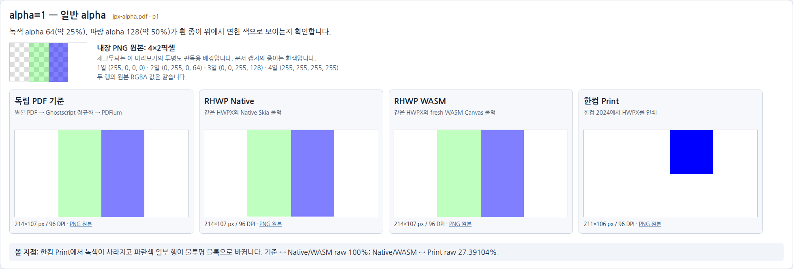
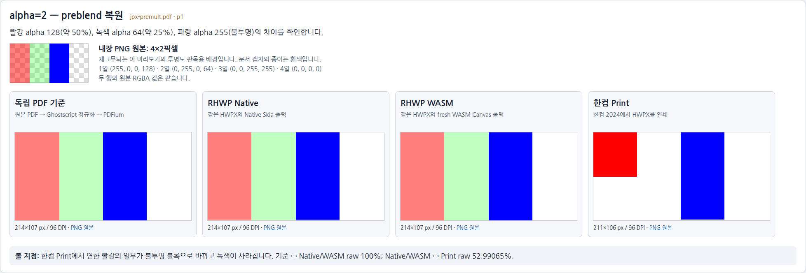

# #8183 반투명 이미지 — 메인테이너 시각 확인

2026-10-24. 제품 source `cfc5be8fe`의 기존 96 DPI 캡처를 같은 픽셀 확대율로 배치했다.
이번 준비에서는 제품 코드·렌더링·점수를 변경하지 않았다. 검토용 PDF는 비교판을 인쇄한
로컬 편의 자료이며, 기존 기준 PDF가 아니다.

**[오프라인 확대 뷰어 열기](../pr/assets/issue_8183/alpha-review/viewer.html)** ·
[전체 비교판 PNG](../pr/assets/issue_8183/alpha-review/overview.png) ·
[검토용 PDF 2쪽](../../output/pr-review/issue8183/alpha-review/alpha-review.pdf)

HTML은 외부 서버 없이 브라우저에서 연다. IDE에서 HTML source가 열리면 파일을 브라우저로 연다.
100%·200%·400% 버튼으로 확대하고, 「한컴 재저장 후 Print도 표시」를 켜서 다섯 번째 열을
확인한다. 화면이 좁으면 비교 행을 가로로 스크롤한다. 각 열의 「PNG 원본」으로 캡처를 내려받을 수 있다.

## 먼저 볼 두 장

각 장은 왼쪽부터 **독립 PDF 기준 → RHWP Native → RHWP WASM → 한컴 Print**다.
위의 체크무늬 미리보기는 내장 4×2 PNG의 투명도를 보기 위한 배경이다.
아래 네 문서 캡처는 흰 종이이며 같은 픽셀 확대율을 적용했다.

### 1. 일반 alpha

녹색은 alpha 64(약 25%), 파랑은 alpha 128(약 50%)다. 흰 종이에서 연두색·연보라색으로
보여야 하는 영역을 확인한다. 한컴 Print에서는 녹색이 사라지고 파란색 일부 행이 불투명하게 표시된다.

### 2. preblend 복원

빨강은 alpha 128(약 50%), 녹색은 alpha 64(약 25%), 파랑은 alpha 255(불투명)다.
연한 빨강·연두색과 불투명 파랑을 구분해 확인한다. 한컴 Print에서는 빨강의 일부가 불투명한
블록으로 바뀌고 녹색이 사라진다.

## 직접 열어 볼 파일

| 사례 | 원본 PDF | 독립 정규화 PDF | 한컴 Print PDF | 한컴 재저장 HWP와 그 Print |
| --- | --- | --- | --- | --- |
| 일반 alpha | [jpx-alpha.pdf](../../pdf/issue8183/jpx-alpha.pdf) | [독립 기준](../../pdf/issue8183/reference/jpx-alpha-gs.pdf) | [HWPX Print](../../pdf/issue8183/hancom-print/jpx-alpha-2024.pdf) | [HWP](../../pdf/issue8183/hancom-print/jpx-alpha-hancom-resaved.hwp) · [Print](../../pdf/issue8183/hancom-print/jpx-alpha-hancom-resaved-2024.pdf) |
| preblend 복원 | [jpx-premult.pdf](../../pdf/issue8183/jpx-premult.pdf) | [독립 기준](../../pdf/issue8183/reference/jpx-premult-gs.pdf) | [HWPX Print](../../pdf/issue8183/hancom-print/jpx-premult-2024.pdf) | [HWP](../../pdf/issue8183/hancom-print/jpx-premult-hancom-resaved.hwp) · [Print](../../pdf/issue8183/hancom-print/jpx-premult-hancom-resaved-2024.pdf) |

이번 로컬 검증의 [일반 alpha HWPX](../../output/pr-review/issue8183/stage3/converted-final/both/jpx-alpha.hwpx),
[preblend HWPX](../../output/pr-review/issue8183/stage3/converted-final/both/jpx-premult.hwpx)도
보존돼 있다. 이 두 경로는 ignored 작업 산출물이며 다른 checkout에는 없을 수 있다.

독립 기준 열은 원본 PDF만 Ghostscript로 정규화한 뒤 PDFium으로 그린 것이다.
원본 JPX를 직접 읽은 PDFium의 alpha 처리 차이와 구분한다. RHWP 출력으로 기준을 만들지 않았다.
한컴 Print는 2024 13.0.0.3901·Print method 0이다. 재저장 HWP의 원래 RGBA 값은 보존됐고
Print는 HWPX Print와 같은 1비트 mask를 만들었다.

## 확인과 판정 기록

- 연두색·연보라색·연한 빨강의 투명도가 의도한 표시인지 확인한다.
- 불투명 파랑과 반투명 파랑을 구분하고, 녹색 영역의 소실과 불투명 블록의 위치를 확인한다.
- HTML의 재저장 열을 켜서 한컴이 저장한 HWP에서도 같은 인쇄 결과가 나오는지 확인한다.

기존 측정은 원본 PDF 기준 Native/WASM 각각 raw 100%, Print 기준은 일반 alpha 27.39104%,
preblend 52.99065%다. **Print 두 쪽의 미달·PR 보류 판정은 유지한다.** 이 비교판으로
자동 승인하거나 기준을 바꾸지 않았다. 메인테이너의 직접 확인 결과는 아직 기록하지 않았다.

[3단계 결과](task_m100_8183_stage3.md) ·
[캡처 출처와 SHA-256](../pr/assets/issue_8183/alpha-review/provenance.json) ·
[기존 Print TSV와 원인 근거](../pr/assets/issue_8183/hancom-print/README.md)
