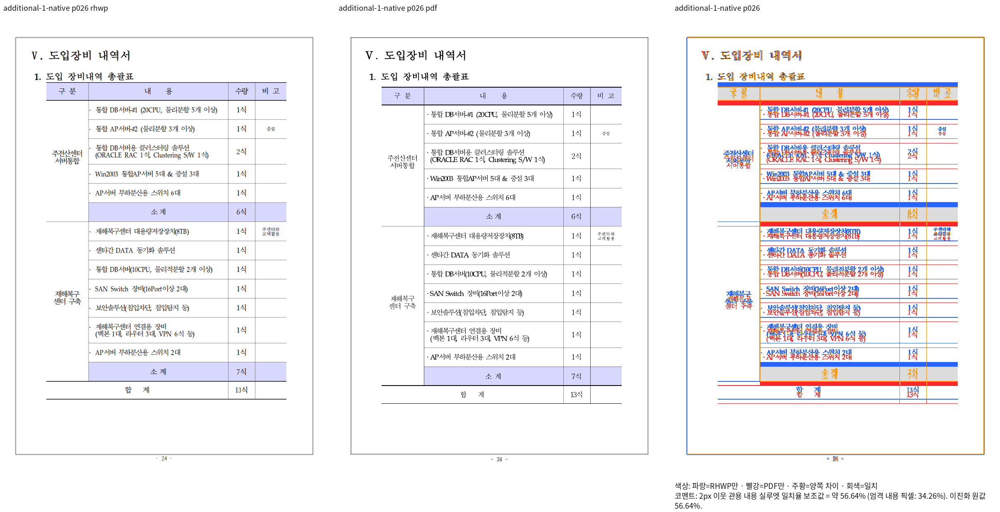
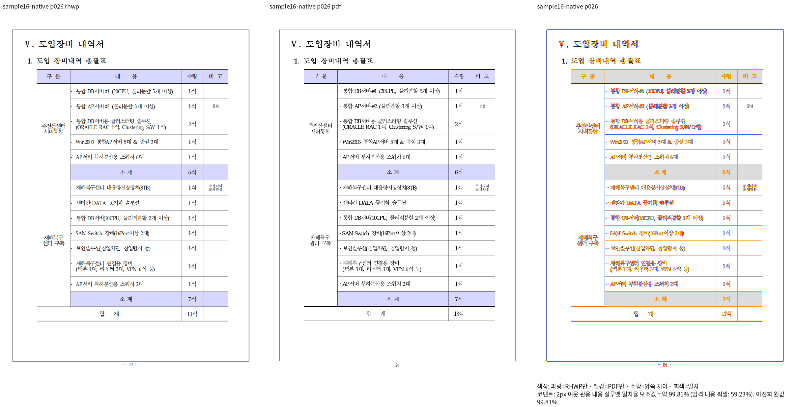

# 저장 단 첫 여백과 후속 표 원점 대조

Issue: #7642

- 원본: `samples/hwp3-sample16-hwp5.hwp`
- 원본 SHA-256: `6a3cdf2c148bf39f40ab06e847767e7f722543fce59e6ee4328ef44b835f3f45`
- 기준: `mydocs/pr/assets/pr_7600_control_print_20261006/input-17-hwp3-sample16-hwp5-2024.pdf`
- 기준 SHA-256: `e25441458879234dee150af856cc45a38a576e607fa44e0630a13e1883112967`
- 독립 한컴 2024 Print job: `228402de-7723-4344-8823-9a71a65c2ead`
- 수정 전 빌드: `339c2f25100cead6537fc4290ea902d9159b7b7e`
- 수정 후 source: `59b2aa9165761fad1f335698f5b362577a1c8b93`
- 수정 후 Native CLI SHA-256: `122299ec6b3215c3983571518e06dcf53baeffa13c1dfddb98d3eda39f610098`
- 물리 26쪽, compat 2024, DPI 96, 전체 글꼴 바이트 포함 SVG와 기본 webfont raster.

| 범위 | 수정 전 | 수정 후 |
| --- | ---: | ---: |
| 26쪽 2px 이웃 관용 내용 실루엣 | 56.63767% | 99.81163% |

표와 자손의 원점은 이미 인증한 첫 문단의 앞 여백 프레임으로 복원했다.
제목·본문의 위치와 표 크기·소유를 유지하며 표의 위 괘선, 중간 행, 합계행을 Print와 직접 대조했다.
전쪽 64쪽과 정상 대조군의 Native 재검증 및 fresh WASM 빌드·대조는 아직 진행 중이다.
이 대표 쪽 통과를 문서 전체 또는 전체 PR gate 통과로 확대하지 않는다.

## 실행 증거

진단·빌드·시각 receipt, 원점 추적, TSV는 ignored
`output/pr-review/issue7642/failed-inputs-20261008/stage15-current-validation/stage344-*`,
`stage345-*`에 보존한다. 빌드 잡은 8개이고 공용 `target/pr-review`를 사용했다.
선택 쪽의 Native 실행 명령은 `stage345-source335-targeted-native-corrected.json`의
`selected_review.command`에 있다. 파일 이름의 이전 `source335` 문구와 별개로
receipt의 실제 `source_commit`과 빌드 입력 해시는 위 source를 고정한다.

| 파일 | SHA-256 |
| --- | --- |
| `sample16-p026-before-native-review.png` | `564436429579ff9c5f7ce440426182c47e763a87e989082868122ba873ef0b04` |
| `sample16-p026-after-native-review.png` | `f08c8ad9403485431c7531535b233dead6f9b43b1186ae8de48e678e74314ef4` |

## Source 348 전쪽 Native/fresh WASM와 정식 관계 검사

보정 코드 `7c30f0a6a6fef1c7732078b8faafc2f867d5e166`의 같은 64쪽 원본과 독립 2024 Print를 전쪽 비교했다.

양쪽 모두 쪽수 64, 최저 91.99347%, 90% 미만·누락 없음이다. 7쪽은 99.79126%, 26쪽은 99.81163%다.

최신 7·26쪽을 직접 판독해 제목·앞 본문·표·후속 본문의 저장 원점, 괘선·합계 행·순서를 확인했다.

새 이름의 검사 `tests/cases/issue_7642_stored_column_margin_owner_relations.rs`는 절대 화면 px 대신 원본 간격/줄·표 높이의 비율과 소유·순서·비겹침을 검사한다.

수정 전 `3a8bd6aac3b995d994be3c0c3bbc248157d2faf7`에서 두 검사 모두 의도한 간격 비율 오류로 FAIL, 보정 코드에서 PASS했다.

전쪽 TSV·재개 provenance·로그는 ignored `output/pr-review/issue7642/failed-inputs-20261008/stage15-current-validation/stage349-*`, `stage357-*`, `stage359-*`, `stage360-*`, `stage364-*`에 보존한다.

전체 PR gate와 회귀 실패 42건의 해소는 별도 진행 중이다. 이 전쪽 통과를 전체 브랜치 승인으로 확대하지 않는다.

| 대표 이미지 | SHA-256 |
| --- | --- |
| [after-source348-native-p007-review.png](after-source348-native-p007-review.png) | `67b043852d1ce482b1a2b2111b91b1aee70f9e94bb007855c3f8bc064c8ecaf4` |
| [after-source348-native-p026-review.png](after-source348-native-p026-review.png) | `f08c8ad9403485431c7531535b233dead6f9b43b1186ae8de48e678e74314ef4` |
| [after-source348-wasm-p007-review.png](after-source348-wasm-p007-review.png) | `7819f042503e85e7f0c74c2cd698273e3e3476505597bbb659b99315162a765f` |
| [after-source348-wasm-p026-review.png](after-source348-wasm-p026-review.png) | `cc189dd0da25875d78b44337a37738c195903e5d7c4dddee99a73488b435d0cd` |
